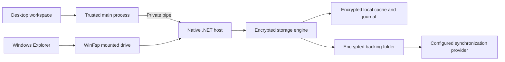
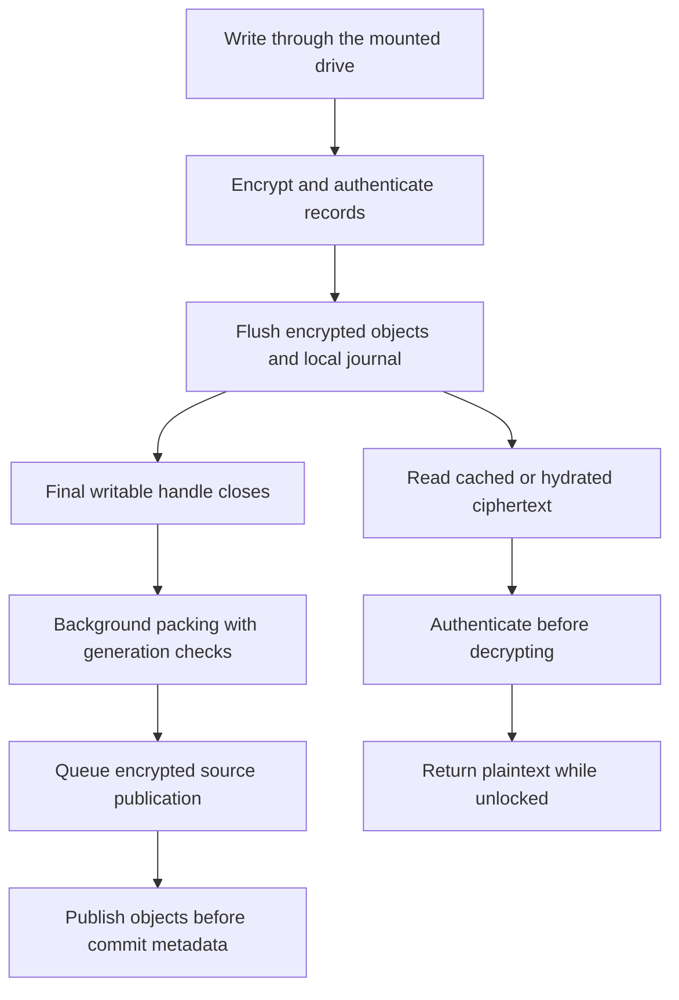

# Material File Encryptor

**An encrypted Windows Explorer drive with recoverable file history and an encrypted offline cache.** The desktop workspace manages storage, transfers, recovery, access controls and local tools. A native .NET engine handles encryption and filesystem operations through WinFsp.

[Documentation website](https://ding-ding-projects.github.io/material-file-encryptor/) · [Feature library](docs/features/README.md) · [中文文件](docs/features/README.zh-HK.md) · [Roadmap](ROADMAP.md) · [Current handoff](HANDOFF.md) · [Releases](https://github.com/Ding-Ding-Projects/material-file-encryptor/releases)

> **Development status:** recorded revision `53d2b4612b96559c5afaac2c28e2888fa0a3ba91` passed the root build, and several package, storage and native boundaries have source-bound evidence. Full feature delivery, complete Material Design 3 conformance, current visual acceptance, installation and update lifecycle remain unfinished. A successful build or published release does not certify those outcomes.

## Start with the workflow you need

| Workflow | What it does | Guide |
|---|---|---|
| Create and unlock a drive | Choose separate encrypted storage and cache folders, set a password or key file, and mount the drive for ordinary Explorer access. | [Drive integration](docs/features/drive/README.md) · [Native storage](docs/features/storage/native-vault.md) |
| Work offline | Pin files or folders so their authenticated encrypted content remains in the local cache. Unpublished changes stay queued when the backing folder is unavailable. | [Transfers and safe lifecycle](docs/features/storage/transfer-lifecycle.md) |
| Recover a change or deletion | Browse retained versions, save a version deliberately, or restore a recoverable Recycle Bin entry. Historical objects remain available; hiding entries does not promise reclaimed storage. | [History and Recycle Bin](docs/features/storage/history-and-recycle-bin.md) · [Selected-file activity](docs/features/storage/file-history-activity.md) |
| Transfer encrypted objects | Use a synchronized backing folder or the configured encrypted Git transport. Provider upload and local durability are separate states. | [Encrypted Git transport](docs/features/storage/git-transport.md) |
| Customize the workspace | Configure language, appearance, typography, motion, schedules and attention behavior. Some editors and contextual guidance remain incomplete. | [Settings](docs/features/interface/settings-completeness.md) · [Appearance](docs/features/interface/appearance-editor.md) · [Guidance](docs/features/interface/settings-guidance.md) |
| Propose a browser download | Pair explicitly, propose a public HTTPS link, then choose a native destination and confirm Start in the desktop. Pairing does not start a transfer or authenticate a browser profile. | [Browser download handoff](docs/features/workflows/browser-download-handoff.md) · [Extension workspace](docs/features/workflows/browser-extension-workspace.md) |
| Inspect additional tools | Local conversion, local models and server preparation have their own supported providers and acceptance limits. A documented component is not proof of a complete running workflow. | [Converter](docs/features/converter/README.md) · [Local models](docs/features/ollama/README.md) · [Server manager](docs/features/server-manager/README.md) |

## Architecture

The desktop sends bounded requests to the native host. Explorer uses the mounted filesystem. The engine stores encrypted content and metadata, while the backing folder's synchronization provider controls its own remote delivery.



The browser extension is a separate proposal surface. Its native messaging broker checks the reviewed origin, explicit pairing and desktop admission. Read-only protection observations distinguish native profile verification from shared mode; `browserPermission` remains `unavailable`. Neither a pairing session nor a protection label grants browser profile authority. See [native transport](docs/features/workflows/browser-native-host.md) and [protection observations](docs/features/workflows/browser-protection-observations.md).

## What happens to a file

Writes first become durable encrypted objects and journal state. Closing the final writable handle can trigger background physical-part packing. Source publication is separate and may remain queued. Reads return authenticated plaintext through the unlocked mounted drive, without a plaintext working folder.



New vaults now default to an **80 MiB physical part cap (83,886,080 bytes)**. The maximum remains **90,000,000 bytes**, including authentication framing. This is a physical storage cap, not a plaintext allocation size. Existing data requires an explicit packing or resplitting workflow; versions and pending work remain protected. [Physical packing and migration](docs/features/storage/physical-packing.md) is the current source of truth for this behavior.

## Current evidence and its limits

Each row below applies only to its recorded source and scope. Later integration does not inherit an earlier binary, capture or installed-runtime verdict.

| Area | Source-bound result | What remains unverified |
|---|---|---|
| Latest integrated root build | `53d2b4612b96559c5afaac2c28e2888fa0a3ba91` passed the exact `build.bat /s` entrypoint with unchanged source at completion. | Packaging and installed execution of later source, full interface interaction and visual acceptance. |
| Reviewed downloadable baseline | Normal release [v1.303.1](https://github.com/Ding-Ding-Projects/material-file-encryptor/releases/tag/v1.303.1), source `3aebe66ded78bbfb0e3b8f8d829e64100371f446`: independent asset hashes, archive integrity and Setup embedding passed; all **861** extracted payload files matched. | Setup execution, installed startup, updater behavior, restart continuity and uninstall acceptance. |
| Encrypted storage packing | Source `e06df2a14643932f5f23289ae4eea2d8e45b3676`: exact root build, **43 native core checks**, synthetic mounted lifecycle and authenticated reopen passed. Measured parts fit the selected physical cap. | Existing user-data migration and the complete current desktop workflow. |
| Portable runtime provisioning | Source `33ed0f8b58b1238ff28264aa0ea8b019759a7a55`: **12 actual native pipe checks** passed, with **315 runtime files and 62 directories** read back against the pinned inventory; host exit was normal. | Java execution, a running server, active cancellation, installed lifecycle and current GUI acceptance. |
| Runtime member lifetime | Source `f2f20c077cccdbb46c572b84df8cc8fca11f89ca`: **8 synthetic lifetime checks** passed. The deliberate negative control exited 1 when protection was removed. | Complete loading-tree isolation, writable-mapping limitations, exact-version configuration admission and real server startup. |
| Compiled protection transport | Test source `adb2f92198c9cf848ddd4377cf778ce84d135da1` passed its actual compiled pipe case using the host built at `53d2b4612b96559c5afaac2c28e2888fa0a3ba91`. The provider was synthetic and browser permission stayed unavailable. An earlier timeout remains retained with its cause unknown. | A real renderer grant, installed extension identity, genuine browser/native interaction and runtime revocation. |
| Package and catalogue optimization | Source `7ad539a937f5c2828572884cc7ef7111290ba62c` removed **560 PDF source maps** while all **994 retained PDF files** remained byte-identical; the exact extracted PDF runtime round-trip passed. A separately measured catalogue cache reduces repeated service work. | Startup improvement, installed memory behavior and compressed installer-size attribution. |

Evidence summaries: [native and package boundaries](docs/evidence/resume-native-20261012.json), [component performance measurements](docs/evidence/resume-performance-20261012.json), [storage measurements](docs/evidence/storage-packing-e06df2a.json), and [release verification](docs/features/release/preview-verification.md). The native summary includes the recorded root build and compiled-pipe result with their separate source and execution limits.

### Feature and interface acceptance

The historical inventory retains **105 feature identifiers and 210 desktop/website rows**. At source `53d2b4612b96559c5afaac2c28e2888fa0a3ba91`, the supplementary registry declares **901 concrete surfaces and 94,605 independently unverified assessments**. Empty proof remains unverified. These are acceptance inventories, not a count of completed features.

Material Design 3 applies to the desktop, documentation website, extension and nested controls. Current layout, keyboard interaction, accessible names, language/theme/scale coverage, complete contextual guidance and the remaining specialized editors require real rendered evidence. The [interface design](DESIGN.md), [surface inventory documentation](docs/features/platform/documentation-and-status.md), [goal](GOAL.md) and [checklist roadmap](ROADMAP.md) describe the unfinished work.

### Current captures

**Current replacement screenshots are pending source-bound acceptance and promotion.** This README does not present an older interface as the latest build.

Historical originals remain available in the [reviewed historical gallery](https://ding-ding-projects.github.io/material-file-encryptor/gallery.html), [original preview inventory](docs/images/captures/preview/inventory.json), [preview verification summary](docs/images/captures/preview/verification-summary.json), [Linux capture provenance](docs/images/captures/provenance.json), and [Windows capture provenance](docs/images/captures/windows/provenance.json). Their original dates, sources, hashes, exclusions and incomplete verdicts remain unchanged. The diagrams here explain behavior; they are not screenshots or runtime evidence.

## Build, package and verify

**Windows 10/11 x64 is the delivery target.** Use the real root entrypoints from a checkout:

```bat
build.bat /s
build-installer.bat /s
```

`build.bat /s` builds the product. `build-installer.bat /s` produces the genuine **unsigned Squirrel.Windows** installer. Windows unknown-publisher warnings are expected for the application installer. A successful build on an existing machine does not certify a fresh installation.

[Bootstrap](scripts/bootstrap.ps1) uses [pinned dependency metadata](dependencies.json), obtains missing supported tools, reuses verified caches and retains download diagnostics. Explorer mounting requires the genuine WinFsp driver and its normal elevation flow. Required consent belongs to the user; the application must not conceal a missing driver or an unavailable route.

Run local verification separately:

```powershell
pwsh -File scripts/verify-local.ps1
```

This script runs broad local checks and prepares its browser tooling; it does not offer per-feature scope selectors. Use the affected feature documentation for focused commands and respect the mounted-check platform requirements. Production GitHub Actions builds and packages through the same entrypoints without tests or lint. Local tests, package inspection, native execution, GUI acceptance and release delivery are separate checks. See [desktop build and verification](docs/features/desktop/README.md), [runtime evidence](docs/features/desktop/runtime-evidence.md), and [release documentation](docs/features/release/README.md).

```mermaid
flowchart LR
    Source["Exact source revision"] --> Build["Root build entrypoint"]
    Build --> Package["Root installer entrypoint"]
    Package --> Bytes["Inspect package and downloaded bytes"]
    Bytes --> Install["Verify installation and updating"]
    Install --> Runtime["Verify native and GUI workflows"]
    Runtime --> Evidence["Review source-bound evidence"]
    Evidence --> Release["Verify normal release and documentation delivery"]
```



This diagram is the verification path, not a claim that every step has passed. Releases must be normal, with draft and prerelease flags false, the intended source, an immutable unique tag and the expected downloadable assets. Published metadata alone never proves installation or runtime behavior.

## Security and recovery boundaries

- Keep credentials and backups outside the encrypted storage and cache roots. Losing all usable unlock credentials loses access; there is no promised password-recovery service.
- Password or key-file credentials protect a randomly generated vault key. Content, namespace metadata, journals and history use authenticated encryption. [Native storage](docs/features/storage/native-vault.md) documents the exact format and derivation.
- Storage and cache roots must be separate and non-overlapping. Managed symbolic-link and Windows reparse paths are rejected.
- Offline pins retain encrypted content. Applications receive plaintext only when reading through the unlocked mounted drive. An unlocked computer can access those files.
- Copying a file outside the mounted drive intentionally creates plaintext. Windows and other applications can create temporary files, thumbnails or paging data.
- Startup registration and optional automatic unlock are separate controls. Automatic unlock uses current-user Windows DPAPI protection; it does not protect data from someone using that already unlocked Windows session.
- Local durability, backing-folder publication and the synchronization provider's remote upload are distinct outcomes. Ciphertext sizes, object counts and activity timing are not hidden.
- History retention and Recycle Bin actions preserve recovery without promising secure erasure or reclaimed space. Failed operations retain their owned recovery state rather than silently discarding it.
- Browser pairing is deliberate and temporary. Downloads still require a desktop destination and confirmation. Read-only protection observations cannot authorize browser profile access or personal wording.
- Server preparation verifies reviewed files without accepting the server license, installing Java globally or starting a server. Local process, local Docker, SSH process and SSH Docker operational acceptance remain unavailable until their own requirements are met.

## Documentation navigation

The documentation website publishes articles and the wiki content directly, with internal navigation. Its publication proof is separate from the latest source and desktop acceptance.

- [All feature categories](docs/features/README.md)
- [Storage and recovery](docs/features/storage/README.md)
- [Desktop and package verification](docs/features/desktop/README.md)
- [Interface workflows](docs/features/interface/README.md)
- [Access and authentication](docs/features/access/README.md)
- [Platform documentation and status](docs/features/platform/README.md)
- [Browser and publication workflows](docs/features/workflows/README.md)
- [Release procedures](docs/features/release/README.md)
- [Changelog](CHANGELOG.md), [goal](GOAL.md), [roadmap](ROADMAP.md), and [handoff](HANDOFF.md)
- [Deployed article library](https://ding-ding-projects.github.io/material-file-encryptor/library.html) and [wiki snapshot](https://ding-ding-projects.github.io/material-file-encryptor/wiki.html)

## Contributing and agent work

Read [AGENTS.md](AGENTS.md), the current handoff and the documentation for the affected workflow before changing the product. Keep changes reviewable and preserve unrelated work. Fetch and reconcile the repository before using its current tree as the basis for implementation.

Use the root build and installer entrypoints for their respective operations. Run proportionate local checks separately, preserve unsuccessful receipts, and distinguish source inspection, synthetic tests, real native execution, rendered behavior and installed lifecycle. Never substitute a mock or historical capture for current runtime evidence.

Update the affected categorized documentation, checklist roadmap and factual handoff with the same change. Bind evidence to its exact source, executable or package hashes, actual route and verification scope. Integrate completed work into `main`, push it and verify the remote ref; keep unfinished recoverable work explicitly incomplete. Never overwrite unrelated changes, force-push without reviewed authorization or remove uncommitted, unmerged or unpushed work.

Keep credentials, private instruction content, machine paths and unapproved user data out of source, history, logs, screenshots and published material. Review publication-bound text and pixels before release. Agents must never initiate or automate restart, shutdown, sign-out, sleep or hibernation of the user's current computer. User-approved settings changes are separate from actual power or login actions. Native elevated consent must be supplied by the user, and external communication requires explicit authorization.

## Agent conversation vocabulary

Agents working in this repository use the shared private conversation vocabulary defined in
the maintainer's canonical agent instructions for every reply, including chat prose, visible
reasoning, status lines, and task or session titles. Read those instructions and apply them
in full. They are deliberately not restated here, because this file is part of this
repository's public record.

That vocabulary never appears in anything published. Keep it out of commit messages, branch
names, code, code comments, test names, documentation, this file, issues, pull requests,
discussions, release notes, published sites, logs, and every other file in this repository.
Published writing uses ordinary professional English, and exact technical identifiers always
keep their literal spelling. The single documented public-safe exception is named in those
canonical instructions; do not infer any other.

Scan any text bound for a public surface against that vocabulary before publishing it. A
reviewer cannot tell a correct release note from a leaking one by reading it, so the scan is
a step, not a habit.
