# Material File Encryptor

**An encrypted Windows Explorer drive with recoverable file history and an encrypted offline cache.** A native .NET engine and WinFsp adapter handle encryption and mounted filesystem operations. The desktop workspace brings storage, transfers, recovery, settings and documentation together.

[Documentation website](https://ding-ding-projects.github.io/material-file-encryptor/) · [Feature library](docs/features/README.md) · [中文文件](docs/features/README.zh-HK.md) · [Roadmap](ROADMAP.md) · [Current handoff](HANDOFF.md) · [Releases](https://github.com/Ding-Ding-Projects/material-file-encryptor/releases)

[Screenshot gallery and verified capture provenance](https://ding-ding-projects.github.io/material-file-encryptor-captures/). Historical captures retain their original source and verification scope.

**Install:** Windows 10 or 11 on x64. Download the unsigned Squirrel.Windows installer from the [releases page](https://github.com/Ding-Ding-Projects/material-file-encryptor/releases); Windows may show an unknown-publisher warning. To build from a checkout, run `build.bat /s` and then `build-installer.bat /s` (see [Build, package and verify](#build-package-and-verify)). Explorer mounting also needs the WinFsp driver.

**Price:** free. There are no purchases, subscriptions or paid features, nothing is unlocked by paying, and nothing here asks for payment details.

**Desktop icon resources:** [installed icon packaging](docs/features/desktop/installed-icons.md) documents the folder-and-lock mark, executable and shortcut resources, installer branding, and the distinction between source checks and installed verification.

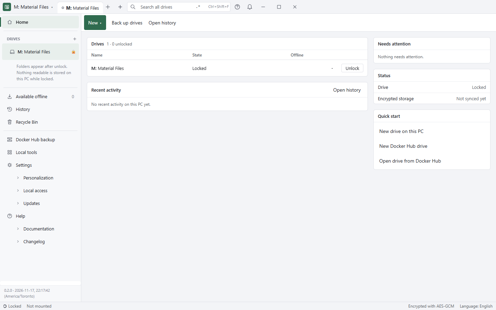

Home in the current build, source `3227a1cc`. More captures, with a receipt for each, are in [Current captures](#current-captures); earlier captures are in the [screenshot archive](docs/screenshots-archive.md).

**Ordinary installed 1.823.1 verification:** Version 1.823.1 is verified in the ordinary user installation from release source `14d6e07636a1f1d62e6dd345273a0c6866664562`. All 910 payload files matched; four opened-file handles resolved to ordinary installation paths. Independent queries through the existing Explorer desktop confirmed the installation folder and Desktop/Start menu shortcut targets. The installer operation returned 0. Its original continuous observer failed, so operation exit and recorded-process absence were recovered separately and remain separate verdicts. The detailed original receipts remain preserved privately. The installed English/light initial setup screen and five native window icon handles were observed with an isolated verification profile. Both ordinary-shell shortcut icon images were separately inspected and show the green folder-lock mark with the shortcut arrow; this is extracted shell-icon evidence, not a rendered Explorer/taskbar/tray screenshot. The runtime observer failed its Python-wrapper identity handshake; separate recovery found every recorded identity absent and the hidden desktop unavailable, while replacement processes were left untouched. Console observation covers only the capture interval, not startup history. Rendered taskbar/tray icons, full workflows and a disposable fresh-machine installation remain unverified. Independent recovery is now recorded separately. Canonical capture promotion remains pending because release source 14d6e07636a1f1d62e6dd345273a0c6866664562 differs from verifier checkout edf13cba77968c81a3c7eca392fdc1f740126868. The genuine capture remains private and unpromoted; no tool-context image is presented as ordinary-installed proof.

**Contents:** [Choose a workflow](#choose-a-workflow) · [Architecture](#architecture) · [What happens to a file](#what-happens-to-a-file) · [Current captures](#current-captures) · [Build, package and verify](#build-package-and-verify) · [Security](#security-and-recovery-boundaries) · [Size and human-time estimate](#project-size-and-human-time-estimate) · [Documentation and contributing](#documentation-and-contributing). Long reference sections are collapsed: choose a summary line to open it.

> **Historical verified baseline:** `411ce5d55b96958799d996713374b7b683552234` records verified PDF packaging and documentation catalogue caching, plus the updater controller and future release-index repair. This is a fixed evidence reference, not the latest main revision. The exact root builds and bounded component results are recorded below. Complete required features, current Material Design 3 acceptance, installed startup, automatic updating and restart continuity remain unfinished. A successful build or release does not certify those outcomes.

Promotion retries retain their verified producer identity and check exact downloaded provenance before current-main promotion. [Release delivery](docs/features/release/preview-delivery.md) distinguishes source checks, downloaded bytes and still-unverified installed behavior.

## Current interface implementation

<details>
<summary>Interface implementation status, feature ledger counts and protected mediation</summary>

The shared titlebar, main workspace, content panel, data table and selection toolbar now use registered components with their own structure, styles and connection lifecycle. Original record rows and action nodes remain in place. The combined source inventory and component checks pass 59 tests. The exact root build of composition candidate `4959f2af4a2ced2980b2a68d2ba9fb4056458e35` passed; its package contains 6,066 entries with zero privacy rejections. Bounded real captures found incomplete table focus visibility. A separately preserved inset-outline candidate exposes the sides and bottom, but its top remains covered by the header. Full rendered composition acceptance remains incomplete. Existing images retain their historical source and do not certify this newer candidate.

The feature ledger now contains 327 assessments: 109 feature families on each of the desktop, website and extension surfaces. Desktop has 99 unverified and 10 not applicable, the website 97 unverified and 12 not applicable, and the extension 98 unverified and 11 not applicable. The combined catalogue declares 1,075 concrete surfaces and 257 public routes; these are inventory counts, not completed workflows.

Protected browser mediation has focused source and compiled synthetic pipe verification. Production profile authentication controls remain unavailable until their native callbacks and real extension interactions are implemented and accepted. [Shared compositions](docs/features/interface/shared-compositions.md) · [Extension assessments](docs/features/platform/extension-assessment.md) · [Protected mediation boundaries](docs/features/interface/protected-browser-mediation.md)

</details>

## Choose a workflow

| Workflow | Behavior and guide |
|---|---|
| Create and unlock a drive | Choose separate encrypted storage and cache roots, set a password or key file, and mount for ordinary Explorer access. [Drive integration](docs/features/drive/README.md) · [Multiple vaults](docs/features/drive/multiple-vaults.md) · [Encrypted folder images](docs/features/drive/encrypted-folder-images.md) · [Native storage](docs/features/storage/native-vault.md) |
| Work offline | Pin authenticated encrypted content in the local cache. Pending publication remains queued when the backing folder is unavailable. [Transfers and safe lifecycle](docs/features/storage/transfer-lifecycle.md) |
| Recover changes or deletions | Browse retained versions and restore recoverable Recycle Bin entries. Retention does not promise reclaimed storage. [History and Recycle Bin](docs/features/storage/history-and-recycle-bin.md) · [File activity](docs/features/storage/file-history-activity.md) |
| Transfer encrypted objects | Use a backing folder or configured encrypted Git transport. Local durability and provider upload are distinct. [Encrypted transport](docs/features/storage/git-transport.md) |
| Back up and synchronize encrypted snapshots | Open Docker Hub storage, verify sign-in, choose explicit public or private visibility, schedule synchronization, inspect immutable revisions, restore into a fresh folder and review concurrent file changes. The synthetic public-provider round trip is verified; installed scheduling and complete GUI acceptance remain pending. [Registry synchronization](docs/features/storage/registry-sync.md) |
| Customize the workspace | Language, appearance, typography, motion and attention controls retain their documented limits. Specialized editors and contextual guidance remain incomplete. [Settings](docs/features/interface/settings-completeness.md) · [Appearance](docs/features/interface/appearance-editor.md) · [Guidance](docs/features/interface/settings-guidance.md) · [Destructive actions](docs/features/interface/destructive-actions.md) |
| Propose a browser download | Pair explicitly, propose a public HTTPS link, then choose a native destination and confirm Start in the desktop. Pairing does not start a transfer or authenticate a browser profile. [Browser download handoff](docs/features/workflows/browser-download-handoff.md) · [Extension workspace](docs/features/workflows/browser-extension-workspace.md) |
| Inspect local tools | Conversion, local models and server preparation require their own supported providers. Their documentation does not certify complete running workflows. [Converter](docs/features/converter/README.md) · [Local models](docs/features/ollama/README.md) · [Server preparation](docs/features/server-manager/README.md) |

Browser workspace, profile mediation, native server provisioning and interface redesign source is integrated on main. Their runtime and visual acceptance remain pending and are not presented here as verified behavior.

## Architecture

The desktop sends bounded requests to the native host. Explorer uses the mounted filesystem. The engine persists encrypted objects and metadata; the configured backing-folder provider controls its own remote delivery.

<details>
<summary>Architecture diagram and the browser extension boundary</summary>

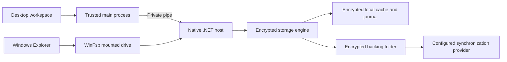

The browser extension is a separate proposal surface. Its native messaging broker checks the reviewed origin, explicit pairing and desktop admission. Read-only protection observations distinguish native profile verification from shared mode; `browserPermission` remains `unavailable`. Neither a pairing session nor a protection label grants browser profile authority. See [native transport](docs/features/workflows/browser-native-host.md) and [protection observations](docs/features/workflows/browser-protection-observations.md).

</details>

## What happens to a file

Writes become durable encrypted objects and journal state before source publication. Closing the final writable handle can trigger background physical-part packing. Reads authenticate ciphertext before returning plaintext through the unlocked drive.

<details>
<summary>File workflow diagram and the physical part cap</summary>

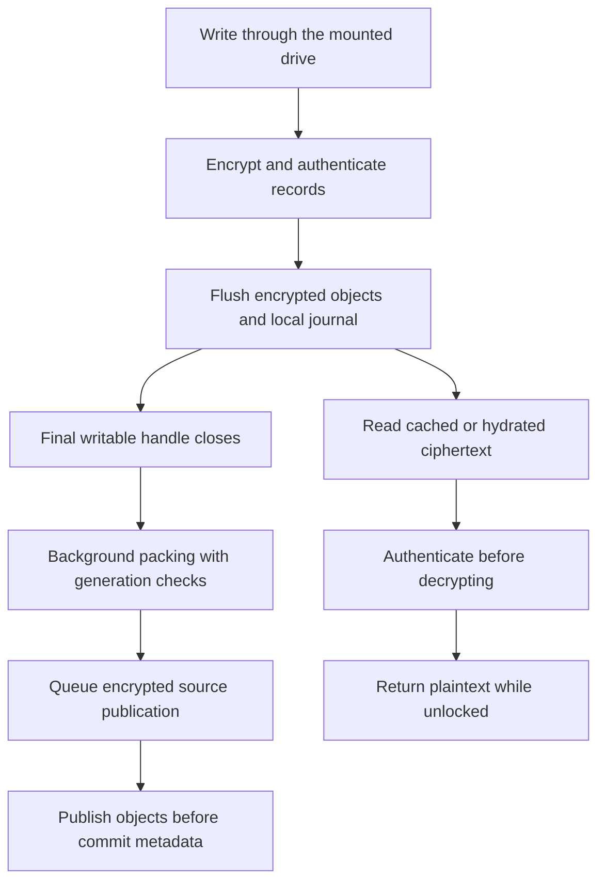

New vaults default to an **80 MiB physical part cap (83,886,080 bytes)**. The maximum remains **90,000,000 bytes**, including authentication framing. Existing data needs explicit packing or resplitting; historical versions and pending work remain protected. See [physical packing](docs/features/storage/physical-packing.md). Existing user-data migration remains deferred.

</details>

## Current continuation

<details>
<summary>Latest recorded continuation and open work</summary>

Main 07a9d286 records the completed e7099d37 strict UTF-8 article repair. All 234 deployed files, the complete deployment archive, article bytes and exact About homepage were accepted at that observation. Later source requires its own live verification.

GUI source 04bf6c25 is preserved remotely with independent merge review and 34 focused checks. Its frozen isolated build started at 2026-10-12T22:58:04.8123288Z; package and runtime remain pending. Separate converter 18f98d53 has accepted build/package production, but actual admission d6e3 failed with BEHAVIORAL_PROBE_FAILED/provider-probe before customer input or hex sanity conversion. Its precise failed subpredicate is unknown; a typed diagnostic variant is planned, not executed.

The 105-family/210-row goal remains open, with 22 routes declared, 67 unavailable providers, zero of 4,272 accepted visual tuples and 74 design gaps. One offline-populated source unit is in progress without acceptance. Installed update and parity remain unfinished; initial installation, removal and real-data migration remain deferred. Deletion awaits the unavailable verified archive destination. See the [handoff](HANDOFF.md) and [roadmap](ROADMAP.md) for source-specific evidence.

</details>

## Source-bound verification

<details>
<summary>Verification table, unfinished delivery and the preview capture history</summary>

Evidence applies to the named source and scope. Later revisions do not inherit earlier installed or visual verdicts.

| Unit | Observed result | Limit |
|---|---|---|
| PDF packaging, `a0239c91d517ca06d9725f36dd76874f5ab33ece` | Exact `build.bat /s` exited 0. All **994 retained PDF files** match source hashes; **560 maps** are excluded. Five extracted-runtime checks cover creation/text, inspection, extraction order, rotation and metadata. Package privacy accepted **5713 entries**, zero rejected. | Existing packager omission of `yarn.lock` is separate. Upstream PDF source mappings are unavailable for runtime debugging. No installer-size or speed claim. |
| Documentation cache, `187364a3094b1f66e5798d10991f2e3d09d40af9` | Exact root build exited 0; package privacy accepted **5714 entries**, zero rejected. Production source bytes match the package. Eight focused checks passed and were independently repeated. | Installed and renderer acceptance remain separate. The cache retains parsed catalogue memory during its service lifetime. |
| Actual cache component timing | On one **7,863,011-byte** packaged catalogue, 31 alternating samples measured **17.3215 ms** fresh versus **0.0182 ms** reused request medians, and **28.5182 ms** versus **0.0065 ms** concurrent medians. First read/parse/freeze took **24.9591 ms**. | Same-host local Node component measurement. Excludes IPC, original ASAR access, renderer work and installed responsiveness. |
| Historical storage baseline | Source `e06df2a14643932f5f23289ae4eea2d8e45b3676` passed its exact build, 43 native core checks and synthetic mounted lifecycle with authenticated reopen. | Existing data migration and complete current desktop interaction remain unverified. |

[Selected public proof](docs/evidence/main-performance-20261012.json) includes package and input hashes, source bindings and limits. The build generator changed only a registered component's line endings; configured normalized source identity was proven. Original build receipts retain that observation. [Package verification](docs/features/desktop/package-integrity.md) and [catalogue caching](docs/features/platform/packaged-documentation-cache.md) describe behavior and trade-offs.

Package inspection also validates each ASAR file's declared SHA-256 and block hashes, including unpacked files. Same-length corruption and missing or malformed integrity metadata are rejected. Embedded hashes establish consistency with the archive header, not publisher authenticity; production, downloaded-byte and installed acceptance remain separate.

### Unfinished delivery and current images

The inventory contains **109 required feature identifiers and 218 desktop/website rows**. It does not count completed features. The [goal](GOAL.md), [roadmap](ROADMAP.md) and [interface design](DESIGN.md) retain the outstanding controls, guidance, accessibility, language/theme/scale states and full visual matrix.

Inspected captures of the rebuilt desktop app appear in [Current captures](#current-captures), with their receipt. The full visual matrix across every language, theme and scale remains pending.

### Verified preview captures

Earlier captures were replaced by the current ones listed below and remain unchanged in Git history, with their original dates, sources and hashes in the [preview inventory](docs/images/captures/preview/inventory.json), [preview summary](docs/images/captures/preview/verification-summary.json), [Linux provenance](docs/images/captures/provenance.json) and [Windows provenance](docs/images/captures/windows/provenance.json). These diagrams explain workflows; they are not screenshots.

Updater source and future BOM-free release-index production are delivered on main. Local installer production passed at `ab975`; main `411ce5d` retains the same complete source tree after a preserved unpublished message correction. Hosted release [v1.344.1](https://github.com/Ding-Ding-Projects/material-file-encryptor/releases/tag/v1.344.1) passed the older installed-controller metadata check with an available verdict, and its independently downloaded Setup/package bytes passed archive and embedding checks. [Selected update proof](docs/evidence/hosted-update-1344-20261012.json) keeps those results separate from pending installed GUI and actual native apply acceptance. Installed startup, ready/Later interaction, restart continuity and removal are not certified. Local models must follow the documented one-click application-managed Ollama runtime procedure. The shared instructions may be updated only after actual installation and runtime proof; no shared physical directory is implied, existing installations remain untouched, and this documentation change starts no model service. See [local model boundaries](docs/features/ollama/local-models.md).

</details>

## Storage write path and part size

<details>
<summary>Write path, publication queue and the 80 MiB physical part cap</summary>

Writes first become durable encrypted objects and journal state. Closing the final writable handle can trigger background physical-part packing. Source publication is separate and may remain queued. Reads return authenticated plaintext through the unlocked mounted drive, without a plaintext working folder.

The [file workflow diagram](#what-happens-to-a-file) above shows this sequence and its separate read and publication paths.

New vaults now default to an **80 MiB physical part cap (83,886,080 bytes)**. The maximum remains **90,000,000 bytes**, including authentication framing. This is a physical storage cap, not a plaintext allocation size. Existing data requires an explicit packing or resplitting workflow; versions and pending work remain protected. [Physical packing and migration](docs/features/storage/physical-packing.md) is the current source of truth for this behavior.

</details>

## Current evidence and its limits

<details>
<summary>Source-bound evidence table, evidence summaries and feature acceptance</summary>

Each row below applies only to its recorded source and scope. Later integration does not inherit an earlier binary, capture or installed-runtime verdict.

| Area | Source-bound result | What remains unverified |
|---|---|---|
| Latest integrated root build | `53d2b4612b96559c5afaac2c28e2888fa0a3ba91` passed the exact `build.bat /s` entrypoint with unchanged source at completion. | Packaging and installed execution of later source, full interface interaction and visual acceptance. |
| Reviewed downloadable baseline | Normal release [v1.303.1](https://github.com/Ding-Ding-Projects/material-file-encryptor/releases/tag/v1.303.1), source `3aebe66ded78bbfb0e3b8f8d829e64100371f446`: independent asset hashes, archive integrity and Setup embedding passed; all **861** extracted payload files matched. | Setup execution, installed startup, updater behavior, restart continuity and uninstall acceptance. |
| Encrypted storage packing | Source `e06df2a14643932f5f23289ae4eea2d8e45b3676`: exact root build, **43 native core checks**, synthetic mounted lifecycle and authenticated reopen passed. Measured parts fit the selected physical cap. | Existing user-data migration and the complete current desktop workflow. |
| Portable runtime provisioning | Source `33ed0f8b58b1238ff28264aa0ea8b019759a7a55`: **12 actual native pipe checks** passed, with **315 runtime files and 62 directories** read back against the pinned inventory; host exit was normal. | Java execution, a running server, active cancellation, installed lifecycle and current GUI acceptance. |
| Runtime member lifetime | Source `f2f20c077cccdbb46c572b84df8cc8fca11f89ca`: **8 synthetic lifetime checks** passed. The deliberate negative control exited 1 when protection was removed. | Complete loading-tree isolation, writable-mapping limitations, exact-version configuration admission and real server startup. |
| Compiled protection transport | Test source `adb2f92198c9cf848ddd4377cf778ce84d135da1` passed its actual compiled pipe case using the host built at `53d2b4612b96559c5afaac2c28e2888fa0a3ba91`. The provider was synthetic and browser permission stayed unavailable. An earlier timeout remains retained with its cause unknown. | A real renderer grant, installed extension identity, genuine browser/native interaction and runtime revocation. |
| Package and catalogue optimization | Source `7ad539a937f5c2828572884cc7ef7111290ba62c` removed **560 PDF source maps** while all **994 retained PDF files** remained byte-identical; the exact extracted PDF runtime round-trip passed. A separately measured catalogue cache reduces repeated service work. | Startup improvement, installed memory behavior and compressed installer-size attribution. |

Evidence summaries: [native and package boundaries](docs/evidence/resume-native-20261012.json), [component performance measurements](docs/evidence/resume-performance-20261012.json), [storage measurements](docs/evidence/storage-packing-e06df2a.json), and [release verification](docs/features/release/preview-verification.md). The native summary includes the recorded root build and compiled-pipe result with their separate source and execution limits.

### Feature and interface acceptance

The historical inventory retains **105 feature identifiers and 210 desktop/website rows**. At source `53d2b4612b96559c5afaac2c28e2888fa0a3ba91`, the supplementary registry declares **901 concrete surfaces and 94,605 independently unverified assessments**. Empty proof remains unverified. These are acceptance inventories, not a count of completed features.

Material Design 3 applies to the desktop, documentation website, extension and nested controls. Current layout, keyboard interaction, accessible names, language/theme/scale coverage, complete contextual guidance and the remaining specialized editors require real rendered evidence. The [interface design](DESIGN.md), [surface inventory documentation](docs/features/platform/documentation-and-status.md), [goal](GOAL.md) and [checklist roadmap](ROADMAP.md) describe the unfinished work.

</details>

### Current captures

Every image below is a genuine capture of the packaged app built from source `3227a1cc` (version 0.2.0), taken in a fresh isolated profile with a hidden window and left unedited. The [capture manifest](docs/images/captures/redesign-v2-3227a1cc/manifest.json) records each image's hash, size, viewport and theme, and lists what was not captured and why. The design decisions behind this frame are in [the version 2 decisions](design/redesign-2026-11/v2-decisions.md). Captures of earlier builds are in the [screenshot archive](docs/screenshots-archive.md).

<details>
<summary>Home as a status dashboard, Home status dashboard, Drive list while the drive is locked (3)</summary>

| Home as a status dashboard with the drives table | Home status dashboard | Drive list while the drive is locked |
|---|---|---|
|  | 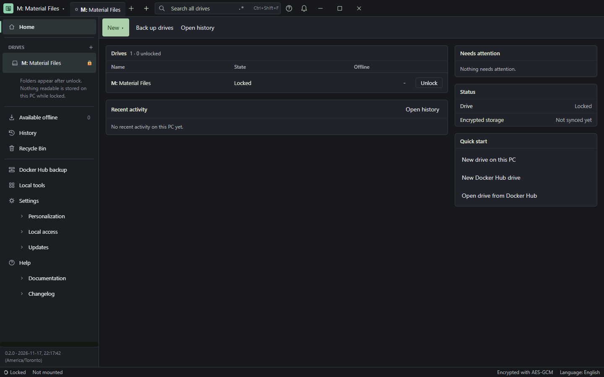 | 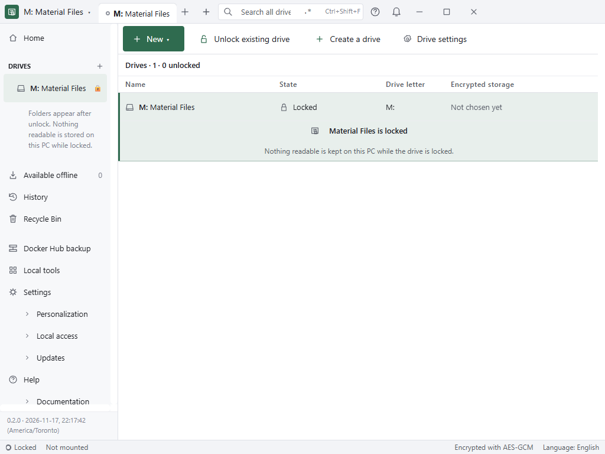 |

</details>

<details>
<summary>New menu offering New drive on this PC, Local tools as a dense list grouped by category, Local tools list (3)</summary>

| New menu offering New drive on this PC | Local tools as a dense list grouped by category with a details pane offering Open and Open in new tab | Local tools list |
|---|---|---|
| 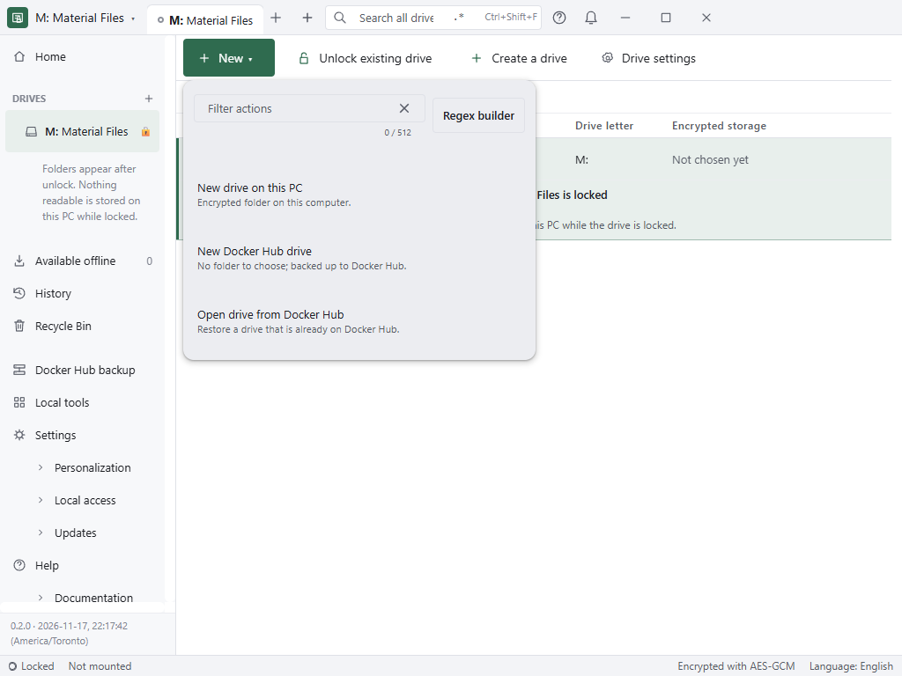 | 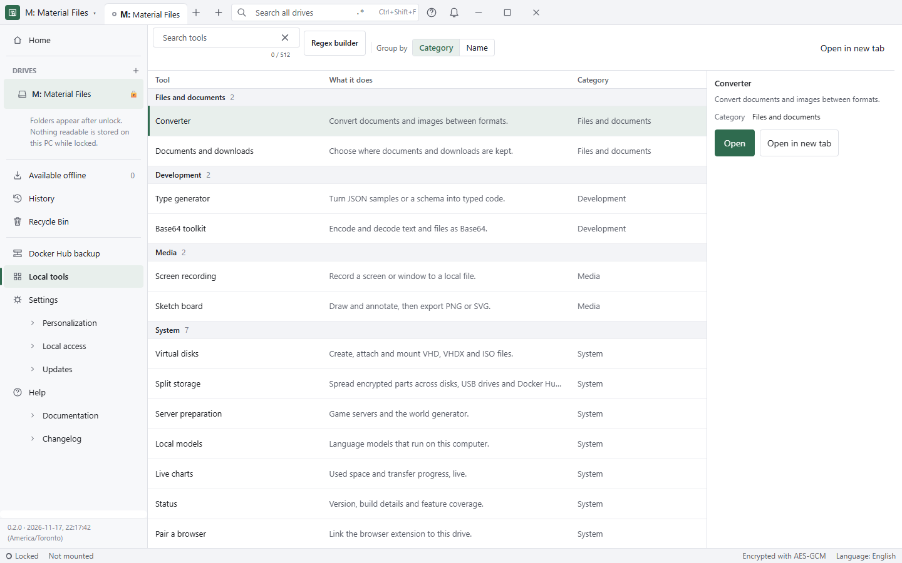 | 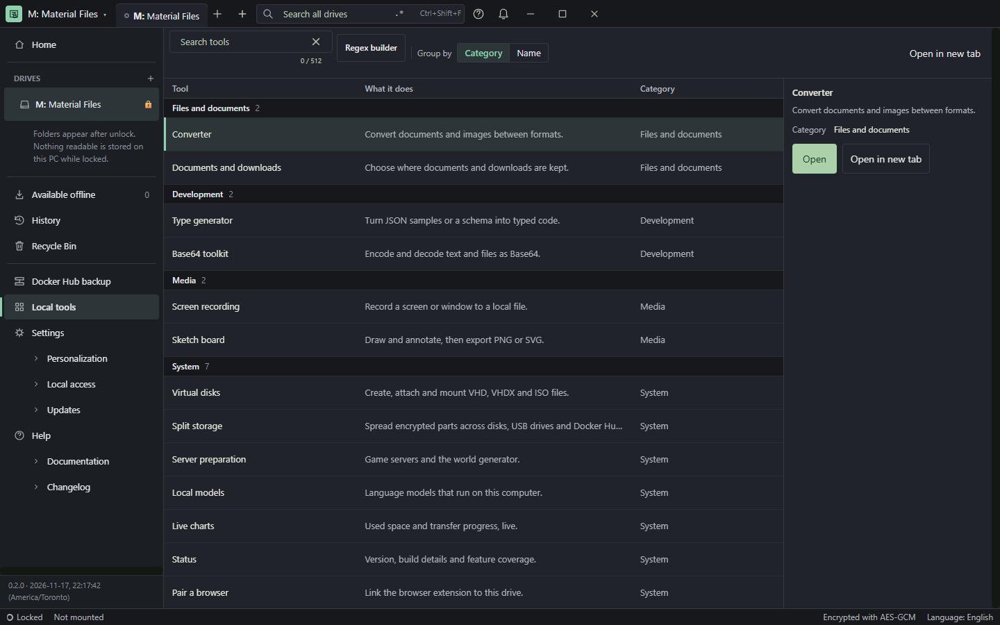 |

</details>

<details>
<summary>Settings, Settings Backup category, Help mode on (3)</summary>

| Settings with a category list and dense label and control rows | Settings Backup category with options that need backend work shown disabled and marked Coming in a later update | Help mode on: the help text of each control shown under it |
|---|---|---|
| 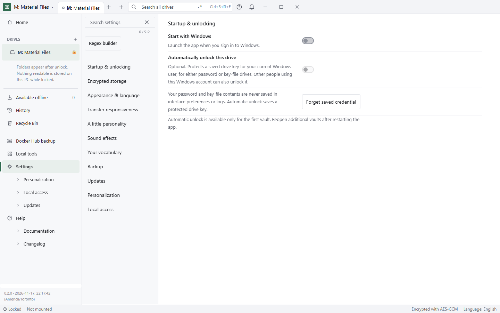 | 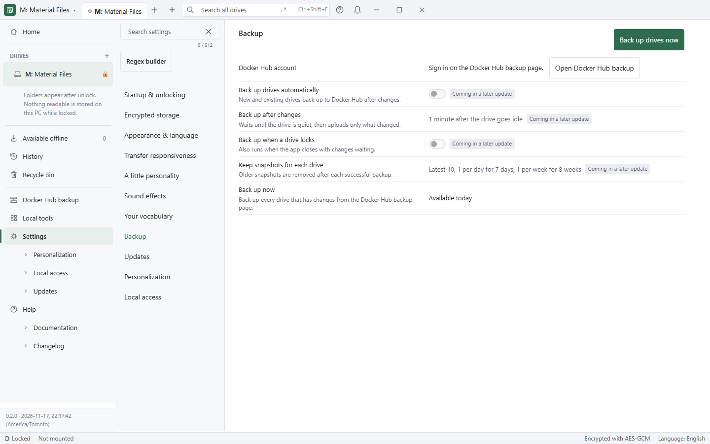 | 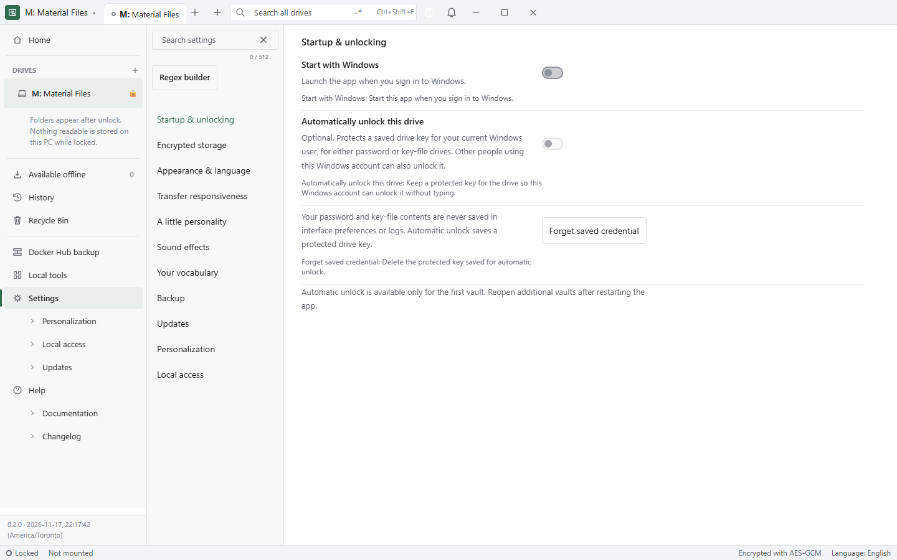 |

</details>

<details>
<summary>Help shown as a tooltip when keyboard focus reaches the New button, History page in the new frame, Recycle Bin page in the new frame (3)</summary>

| Help shown as a tooltip when keyboard focus reaches the New button | History page in the new frame | Recycle Bin page in the new frame |
|---|---|---|
| 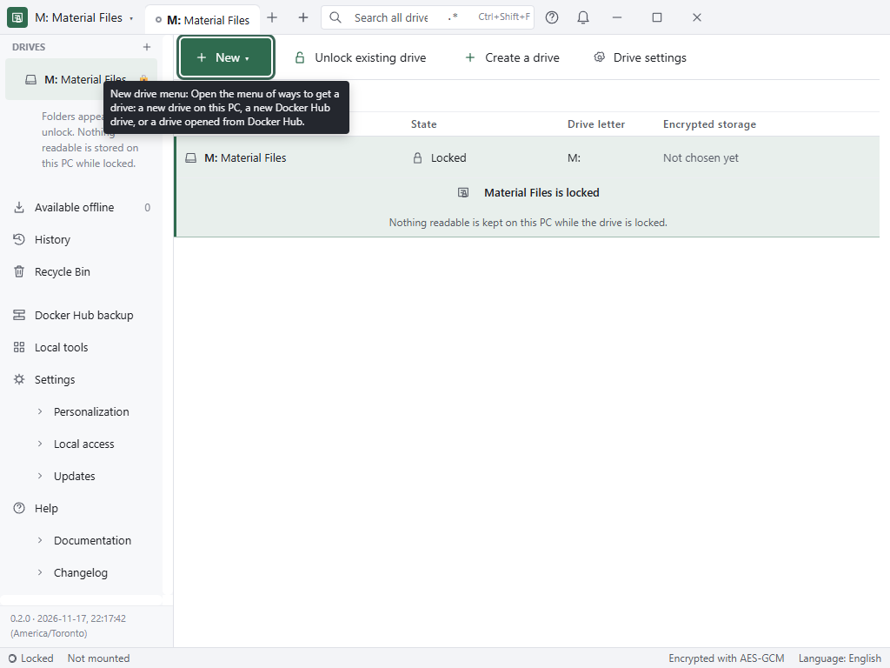 | 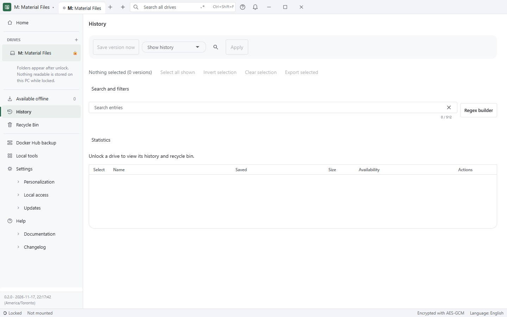 | 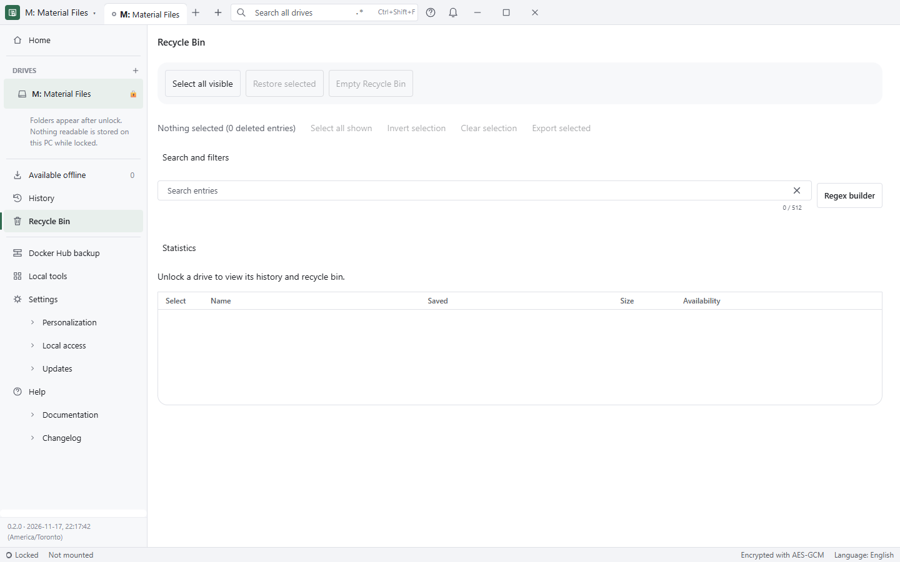 |

</details>

<details>
<summary>Drive list at 360 pixels wide, Navigation drawer at 360 pixels wide (2)</summary>

| Drive list at 360 pixels wide | Navigation drawer at 360 pixels wide with every tree destination |
|---|---|
| 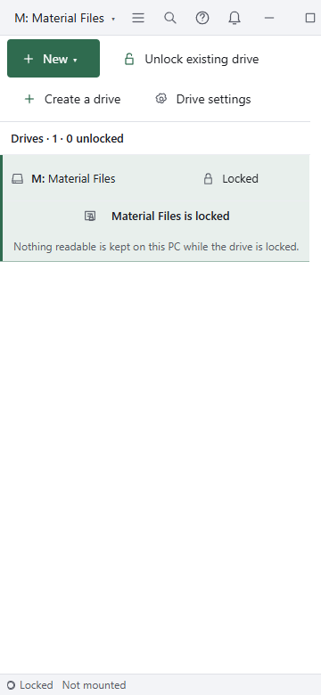 | 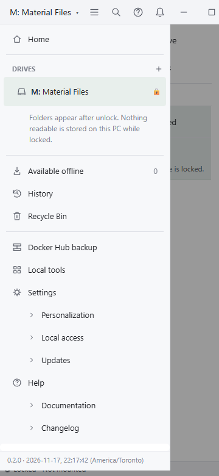 |

</details>


Earlier builds' captures, with their original dates and provenance, are in the [screenshot archive](docs/screenshots-archive.md).

## Build, package and verify

**Windows 10/11 x64 is the delivery target.** Use the real root entrypoints from a checkout:

```bat
build.bat /s
build-installer.bat /s
```

The first builds the product. The second produces the genuine **unsigned Squirrel.Windows** installer. Unknown-publisher warnings are expected. [Bootstrap](scripts/bootstrap.ps1) uses [pinned dependency metadata](dependencies.json), obtains missing supported tools and reuses verified caches. Explorer mounting requires the genuine WinFsp driver and user-supplied elevation where applicable. A required license, unavailable credential or restart remains a separate boundary.

Local checks are separate from production:

```powershell
pwsh -NoProfile -File scripts/verify-local.ps1
```

This script runs broad local checks; consult affected feature documentation for focused checks. Production GitHub Actions runs builds and packaging without tests or lint. Build, package inspection, native execution, GUI interaction and release delivery are separate verdicts.

```mermaid
flowchart LR
    Source["Exact source revision"] --> Build["Root build entrypoint"]
    Build --> Package["Root installer entrypoint"]
    Package --> Bytes["Inspect package and downloaded bytes"]
    Bytes --> Install["Verify installation and updating"]
    Install --> Runtime["Verify native and GUI workflows"]
    Runtime --> Evidence["Review source-bound evidence"]
    Evidence --> Release["Verify normal release and documentation delivery"]
```

The verification diagram is a path, not a claim that every step passed. Releases must have draft and prerelease flags false, an immutable unique tag, intended source and verified assets. Hosted metadata alone does not prove installation or runtime behavior.

## Security and recovery boundaries

<details>
<summary>Security, privacy and recovery boundaries in full</summary>

- Keep credentials and backups outside storage/cache roots. There is no promised password-recovery service.
- Password or key-file credentials protect the vault key. Content, namespace metadata, journals and history use authenticated encryption. [Native storage](docs/features/storage/native-vault.md) specifies the format.
- Storage and cache roots must be separate and non-overlapping. Managed symbolic-link and reparse paths are rejected.
- Applications receive plaintext through the unlocked drive. Copying outside it intentionally creates plaintext; Windows or other applications may also retain temporary data.
- Startup registration and current-user protected automatic unlock are separate controls. Automatic unlock does not protect data from an already unlocked operating-system session.
- Local durability, source publication and synchronization-provider upload are distinct. Ciphertext sizes, object counts and activity timing are not hidden.
- History and recycling preserve recovery without promising secure erasure or reclaimed space. Failed operations retain recovery state.
- Browser pairing is deliberate and temporary. Downloads still require a desktop destination and confirmation. Read-only protection observations cannot authorize browser profile access or personal wording.
- Server preparation verifies reviewed files without accepting the server license, installing Java globally or starting a server. Local process, local Docker, SSH process and SSH Docker operational acceptance remain unavailable until their own requirements are met.
- Existing installations, mounted user data and incomplete branches remain protected while verification continues.

</details>

## Project size and human-time estimate

**Estimate, not a measurement:** writing this project by hand would plausibly take one person about **115.4 to 230.8 person-months** (2,308 to 4,616 working days). Nobody built it that way; this gives a sense of scale and is not a claim about effort, quality or value.

| Hand-written code | Files | Non-blank lines | Multiplier | Weighted lines |
|---|---:|---:|---:|---:|
| Application source (JavaScript) | 488 | 43,415 | 1 | 43,415 |
| Native engine and drive adapter (C#) | 60 | 8,573 | 1.5 | 12,860 |
| Styles and markup (CSS, HTML) | 35 | 1,951 | 1 | 1,951 |
| Tests | 507 | 40,641 | 1 | 40,641 |
| Build, release and tooling scripts | 159 | 16,535 | 1 | 16,535 |
| **Total** | | **111,115** | | **115,402** |

**Arithmetic:** 115,402 weighted lines ÷ 50 lines per day = 2,308 days, and 115,402 ÷ 25 = 4,616 days; at 20 working days per month that is 115.4 to 230.8 person-months.

**Assumptions:** 25 (conservative) to 50 (optimistic) non-blank lines per 8-hour day of finished, reviewed, debugged code, a common industry rule of thumb rather than a measurement of this team. The native engine counts at 1.5 times because encrypted storage and a filesystem adapter are harder than their size suggests. Part of the application source is written as long lines, so line counts understate it. Design, research and review time beyond the test code are not included.

**Left out, exactly as the line count leaves them out:** images, JSON data and catalogues, and other non-code files (329 files); Markdown prose (counted separately, not estimated) (274 files); design reference prototypes (104 files); vendored, bundled or build-output trees (16 files); lockfiles (1 files). Markdown prose (17,607 non-blank lines in 274 files) is not estimated.

Reproduce it with `node scripts/human-time-estimate.mjs` (prints the same table from `git ls-files`) and refresh this block with `node scripts/human-time-estimate.mjs --write`. The block may lag the tree by up to 10 percent before `--check` and the test fail.

## Documentation and contributing

Browse [all categories](docs/features/README.md), [storage](docs/features/storage/README.md), [desktop verification](docs/features/desktop/README.md), [interface](docs/features/interface/README.md), [access](docs/features/access/README.md), [platform](docs/features/platform/README.md), [release procedures](docs/features/release/README.md), [changelog](CHANGELOG.md), [deployed library](https://ding-ding-projects.github.io/material-file-encryptor/library.html) and [wiki snapshot](https://ding-ding-projects.github.io/material-file-encryptor/wiki.html). Live documentation delivery is separate from this source revision.

Read [AGENTS.md](AGENTS.md), the handoff and affected documentation before editing. Preserve unrelated work, reconcile fetched history, use the root entrypoints, run proportionate local checks and retain failed receipts. Integrate completed work into `main`, push it and verify the remote ref. Keep unfinished work explicitly incomplete, never force-push without reviewed authorization, and never delete uncommitted, unmerged or unpushed work.

Keep credentials, private instructions, machine paths and unapproved data out of source and published material. Review text and pixels before publication. Agents must never initiate restart, shutdown, sign-out, sleep or hibernation of the user's current computer. User-approved settings changes are separate from actual power actions; native elevated consent comes from the user. External communications require explicit authorization.

The root [CONTRIBUTING.md](CONTRIBUTING.md), [SECURITY.md](SECURITY.md), [CODE_OF_CONDUCT.md](CODE_OF_CONDUCT.md) and [LICENSE](LICENSE) files appear as tabs above this README on GitHub, so they are not repeated here.

## Agent conversation vocabulary

Agents working in this repository use the shared private conversation vocabulary defined in
the maintainer's canonical agent instructions for every reply, including chat prose, visible
reasoning, status lines, and task or session titles. Read those instructions and apply them
in full. They are deliberately not restated here, because this file is part of this
repository's public record.

That vocabulary never appears in anything published. Keep it out of commit messages, branch
names, code, code comments, test names, documentation, this file, issues, pull requests,
discussions, release notes, published sites, logs, and every other file in this repository.
Published writing uses ordinary professional English, and exact technical identifiers always
keep their literal spelling. The single documented public-safe exception is named in those
canonical instructions; do not infer any other.

Scan any text bound for a public surface against that vocabulary before publishing it. A
reviewer cannot tell a correct release note from a leaking one by reading it, so the scan is
a step, not a habit.

## Guidance and responsive interface candidate

<details>
<summary>Guidance playgrounds, responsive documentation controls and the table focus ring</summary>

The current candidate replaces persistent guidance text entries with accessible information icons and isolated worked examples. All 88 static settings descriptors have authored practice fixtures; scheduled scalar values, clear actions and snapshot operations have separate synthetic examples. Other control families and the complete built acceptance inventory remain unfinished. See [guidance playgrounds](docs/features/interface/guidance-playgrounds.md) for exact boundaries and remaining work.

Every capable control in the desktop shell markup, on the website's home page and shared preferences dialog, and in the browser extension popup and workspace now has its own compact information icon immediately before it. The icon opens a control-specific explanation, guided steps and an isolated worked sample that never starts the real operation or reads a live value. A guard test removes the icon, the target binding, the keyboard action and the contextual panel one at a time and requires each removal to fail, and a coverage test reads each page's markup so an unexplained control fails. Controls that feature modules create after start-up are not covered yet, and no built-app capture of these icons is recorded. See [information icons](docs/features/interface/info-icon-guidance.md).

The desktop app also has a first-run [setup guide](docs/features/interface/setup-guide.md): language and appearance, a read-only WinFsp and server runtime check, naming a drive and opening the existing create or unlock dialog, and showing the browser pairing code. It saves progress, can be skipped, works from the keyboard, and reopens from Help or the command palette. Its source checks use fakes for the preference, driver, dialog and pairing services; a built-app run and capture of the first-run flow are not recorded yet.

Public document controls now prepare real Material Web components before listeners and localization snapshots. The navigation menu follows its measured header height, and tab information panels use the actual navigation scrollport width. Focused source checks pass; two representative source-bound documentation captures are inspected and inventoried. The full language/theme/scale matrix and live publication checks remain pending. Existing historical images retain their original provenance.

The table keyboard-focus ring now paints above sticky headers. Independent review verified twelve source-bound captures and unchanged geometry at both desktop sizes. This bounded English, scale-1 result does not complete the full visual acceptance matrix.

</details>

## Browser workflow source update

<details>
<summary>Browser workspace notes and external-editor workflow (English and Cantonese)</summary>

The browser workspace includes full note reading and an external-editor workflow using native file selection, signed-editor selection and explicit desktop confirmation. See [browser workflows](docs/features/browser/README.md) for behavior and verification boundaries. Current installed-extension, native-dialog and visual acceptance remains pending; earlier captures retain their original source identity.

瀏覽器工作區加入完整筆記閱讀，同經原生檔案選擇、已簽署編輯器選擇及桌面確認嘅外部編輯流程。行為同驗證邊界見[瀏覽器工作流程](docs/features/browser/README.zh-HK.md)。目前安裝後擴充功能、原生對話框同畫面驗收仍然待做，舊畫面證據保留原本來源身份。

</details>

**Encrypted registry storage:** [backup, restore and configurable synchronization](docs/features/storage/registry-sync.md) describes immutable revisions, multi-computer conflicts, mounted snapshots and signed-in background schedules. The direct Docker Hub storage entry is included in normal release v1.851.1. The [synthetic public-provider round trip](docs/evidence/registry-public-6bf655f9.json) and [source-bound root build](docs/evidence/registry-build-015bfac7.json) have independent evidence; installed scheduling and complete GUI acceptance remain pending.

Selected-session registry conflict review now includes strict reviewed-version validation and a main-owned confirmation boundary in local source. Packaged and mounted acceptance remain pending; see [registry synchronization](docs/features/storage/registry-sync.md#version-bound-conflict-review) for the current behavior and evidence limits.

[Reviewed historical screenshot gallery](https://ding-ding-projects.github.io/material-file-encryptor-captures/) contains the separate public evidence inventory and its limits. Current registry/conflict runtime screenshots remain pending.

Registry storage source now includes guided official device sign-in and an explicit public/private destination choice. Existing private settings retain their visibility. Focused source checks pass; the rebuilt sign-in flow, console teardown and production round trip remain unverified. See the [guided sign-in documentation](docs/features/storage/registry-sync.md#guided-sign-in-and-explicit-visibility).

Open **Docker Hub storage** from the main navigation to reach sign-in and backup destination setup directly. The storage view leads with sync, schedule and restore controls, while retaining packing and image export below them. The downloaded console relay has separate [native lifecycle evidence](docs/evidence/registry-login-native-81cb8ca5.json); live interface and installed-update verification remain distinct.
