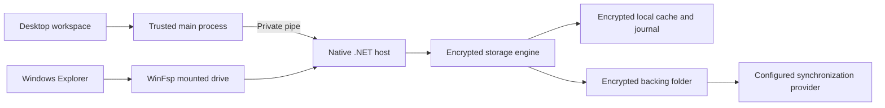
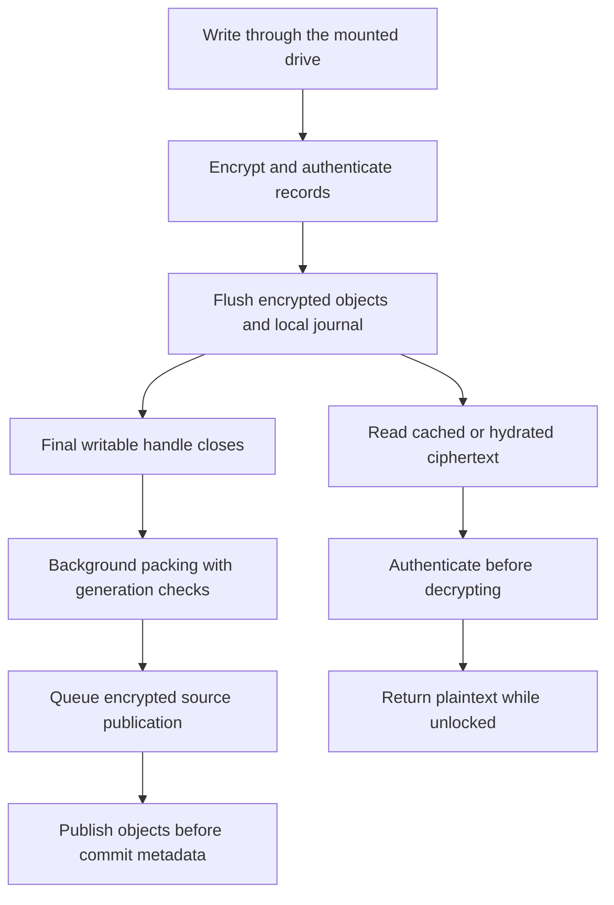

```mermaid
flowchart LR
    Source["Exact source revision"] --> Build["Root build entrypoint"]
    Build --> Package["Root installer entrypoint"]
    Package --> Bytes["Inspect package and downloaded bytes"]
    Bytes --> Install["Verify installation and updating"]
    Install --> Runtime["Verify native and GUI workflows"]
    Runtime --> Evidence["Review source-bound evidence"]
    Evidence --> Release["Verify normal release and documentation delivery"]
```

# Material File Encryptor

**An encrypted Windows Explorer drive with recoverable file history and an encrypted offline cache.** A native .NET engine and WinFsp adapter handle encryption and mounted filesystem operations. The desktop workspace brings storage, transfers, recovery, settings and documentation together.

[Documentation website](https://ding-ding-projects.github.io/material-file-encryptor/) · [Feature library](docs/features/README.md) · [中文文件](docs/features/README.zh-HK.md) · [Roadmap](ROADMAP.md) · [Current handoff](HANDOFF.md) · [Releases](https://github.com/Ding-Ding-Projects/material-file-encryptor/releases)

> **Historical verified baseline:** `411ce5d55b96958799d996713374b7b683552234` records verified PDF packaging and documentation catalogue caching, plus the updater controller and future release-index repair. This is a fixed evidence reference, not the latest main revision. The exact root builds and bounded component results are recorded below. Complete required features, current Material Design 3 acceptance, installed startup, automatic updating and restart continuity remain unfinished. A successful build or release does not certify those outcomes.

## Choose a workflow

| Workflow | Behavior and guide |
|---|---|
| Create and unlock a drive | Choose separate encrypted storage and cache roots, set a password or key file, and mount for ordinary Explorer access. [Drive integration](docs/features/drive/README.md) · [Native storage](docs/features/storage/native-vault.md) |
| Work offline | Pin authenticated encrypted content in the local cache. Pending publication remains queued when the backing folder is unavailable. [Transfers and safe lifecycle](docs/features/storage/transfer-lifecycle.md) |
| Recover changes or deletions | Browse retained versions and restore recoverable Recycle Bin entries. Retention does not promise reclaimed storage. [History and Recycle Bin](docs/features/storage/history-and-recycle-bin.md) · [File activity](docs/features/storage/file-history-activity.md) |
| Transfer encrypted objects | Use a backing folder or configured encrypted Git transport. Local durability and provider upload are distinct. [Encrypted transport](docs/features/storage/git-transport.md) |
| Customize the workspace | Language, appearance, typography, motion and attention controls retain their documented limits. Specialized editors and contextual guidance remain incomplete. [Settings](docs/features/interface/settings-completeness.md) · [Appearance](docs/features/interface/appearance-editor.md) · [Guidance](docs/features/interface/settings-guidance.md) |
| Inspect local tools | Conversion, local models and server preparation require their own supported providers. Their documentation does not certify complete running workflows. [Converter](docs/features/converter/README.md) · [Local models](docs/features/ollama/README.md) · [Server preparation](docs/features/server-manager/README.md) |

Newer browser workspace, profile mediation, native server provisioning and interface redesign work remain on recovery branches. They are not presented here as delivered main behavior.

## Architecture

The desktop sends bounded requests to the native host. Explorer uses the mounted filesystem. The engine persists encrypted objects and metadata; the configured backing-folder provider controls its own remote delivery.



## What happens to a file

Writes become durable encrypted objects and journal state before source publication. Closing the final writable handle can trigger background physical-part packing. Reads authenticate ciphertext before returning plaintext through the unlocked drive.



New vaults default to an **80 MiB physical part cap (83,886,080 bytes)**. The maximum remains **90,000,000 bytes**, including authentication framing. Existing data needs explicit packing or resplitting; historical versions and pending work remain protected. See [physical packing](docs/features/storage/physical-packing.md). Existing user-data migration remains deferred.

## Source-bound verification

Evidence applies to the named source and scope. Later revisions do not inherit earlier installed or visual verdicts.

| Unit | Observed result | Limit |
|---|---|---|
| PDF packaging, `a0239c91d517ca06d9725f36dd76874f5ab33ece` | Exact `build.bat /s` exited 0. All **994 retained PDF files** match source hashes; **560 maps** are excluded. Five extracted-runtime checks cover creation/text, inspection, extraction order, rotation and metadata. Package privacy accepted **5713 entries**, zero rejected. | Existing packager omission of `yarn.lock` is separate. Upstream PDF source mappings are unavailable for runtime debugging. No installer-size or speed claim. |
| Documentation cache, `187364a3094b1f66e5798d10991f2e3d09d40af9` | Exact root build exited 0; package privacy accepted **5714 entries**, zero rejected. Production source bytes match the package. Eight focused checks passed and were independently repeated. | Installed and renderer acceptance remain separate. The cache retains parsed catalogue memory during its service lifetime. |
| Actual cache component timing | On one **7,863,011-byte** packaged catalogue, 31 alternating samples measured **17.3215 ms** fresh versus **0.0182 ms** reused request medians, and **28.5182 ms** versus **0.0065 ms** concurrent medians. First read/parse/freeze took **24.9591 ms**. | Same-host local Node component measurement. Excludes IPC, original ASAR access, renderer work and installed responsiveness. |
| Historical storage baseline | Source `e06df2a14643932f5f23289ae4eea2d8e45b3676` passed its exact build, 43 native core checks and synthetic mounted lifecycle with authenticated reopen. | Existing data migration and complete current desktop interaction remain unverified. |

[Selected public proof](docs/evidence/main-performance-20261012.json) includes package and input hashes, source bindings and limits. The build generator changed only a registered component's line endings; configured normalized source identity was proven. Original build receipts retain that observation. [Package verification](docs/features/desktop/package-integrity.md) and [catalogue caching](docs/features/platform/packaged-documentation-cache.md) describe behavior and trade-offs.

Package inspection also validates each ASAR file's declared SHA-256 and block hashes, including unpacked files. Same-length corruption and missing or malformed integrity metadata are rejected. Embedded hashes establish consistency with the archive header, not publisher authenticity; production, downloaded-byte and installed acceptance remain separate.

### Unfinished delivery and current images

The historical inventory contains **105 required feature identifiers and 210 desktop/website rows**. It does not count completed features. The [goal](GOAL.md), [roadmap](ROADMAP.md) and [interface design](DESIGN.md) retain the outstanding controls, guidance, accessibility, language/theme/scale states and full visual matrix.

**Current replacement screenshots remain pending source-bound acceptance and promotion.**

### Verified preview captures

Historical originals retain their dates, sources, hashes and exclusions in the [preview inventory](docs/images/captures/preview/inventory.json), [preview summary](docs/images/captures/preview/verification-summary.json), [Linux provenance](docs/images/captures/provenance.json), [Windows provenance](docs/images/captures/windows/provenance.json) and [historical gallery](https://ding-ding-projects.github.io/material-file-encryptor/gallery.html). These diagrams explain workflows; they are not screenshots.

Updater source and future BOM-free release-index production are delivered on main. Local installer production passed at `ab975`; main `411ce5d` retains the same complete source tree after a preserved unpublished message correction. Hosted release [v1.344.1](https://github.com/Ding-Ding-Projects/material-file-encryptor/releases/tag/v1.344.1) passed the older installed-controller metadata check with an available verdict, and its independently downloaded Setup/package bytes passed archive and embedding checks. [Selected update proof](docs/evidence/hosted-update-1344-20261012.json) keeps those results separate from pending installed GUI and actual native apply acceptance. Installed startup, ready/Later interaction, restart continuity and removal are not certified. Local models must follow the documented one-click application-managed Ollama runtime procedure. The shared instructions may be updated only after actual installation and runtime proof; no shared physical directory is implied, existing installations remain untouched, and this documentation change starts no model service. See [local model boundaries](docs/features/ollama/local-models.md).

## Build, package and verify

Windows 10/11 x64 is the delivery target. Use the actual root entrypoints:

```bat
build.bat /s
build-installer.bat /s
```

The first builds the product. The second produces the genuine **unsigned Squirrel.Windows** installer. Unknown-publisher warnings are expected. [Bootstrap](scripts/bootstrap.ps1) uses [pinned dependency metadata](dependencies.json), obtains missing supported tools and reuses verified caches. Explorer mounting requires the genuine WinFsp driver and user-supplied elevation where applicable. A required license, unavailable credential or restart remains a separate boundary.

Local checks are separate from production:

```powershell
pwsh -NoProfile -File scripts/verify-local.ps1
```

This script runs broad local checks; consult affected feature documentation for focused checks. Production GitHub Actions runs builds and packaging without tests or lint. Build, package inspection, native execution, GUI interaction and release delivery are separate verdicts.



The verification diagram is a path, not a claim that every step passed. Releases must have draft and prerelease flags false, an immutable unique tag, intended source and verified assets. Hosted metadata alone does not prove installation or runtime behavior.

## Security and recovery boundaries

- Keep credentials and backups outside storage/cache roots. There is no promised password-recovery service.
- Password or key-file credentials protect the vault key. Content, namespace metadata, journals and history use authenticated encryption. [Native storage](docs/features/storage/native-vault.md) specifies the format.
- Storage and cache roots must be separate and non-overlapping. Managed symbolic-link and reparse paths are rejected.
- Applications receive plaintext through the unlocked drive. Copying outside it intentionally creates plaintext; Windows or other applications may also retain temporary data.
- Startup registration and current-user protected automatic unlock are separate controls. Automatic unlock does not protect data from an already unlocked operating-system session.
- Local durability, source publication and synchronization-provider upload are distinct. Ciphertext sizes, object counts and activity timing are not hidden.
- History and recycling preserve recovery without promising secure erasure or reclaimed space. Failed operations retain recovery state.
- Existing installations, mounted user data and incomplete branches remain protected while verification continues.

## Documentation and contributing

Browse [all categories](docs/features/README.md), [storage](docs/features/storage/README.md), [desktop verification](docs/features/desktop/README.md), [interface](docs/features/interface/README.md), [access](docs/features/access/README.md), [platform](docs/features/platform/README.md), [release procedures](docs/features/release/README.md), [changelog](CHANGELOG.md), [deployed library](https://ding-ding-projects.github.io/material-file-encryptor/library.html) and [wiki snapshot](https://ding-ding-projects.github.io/material-file-encryptor/wiki.html). Live documentation delivery is separate from this source revision.

Read [AGENTS.md](AGENTS.md), the handoff and affected documentation before editing. Preserve unrelated work, reconcile fetched history, use the root entrypoints, run proportionate local checks and retain failed receipts. Integrate completed work into `main`, push it and verify the remote ref. Keep unfinished work explicitly incomplete, never force-push without reviewed authorization, and never delete uncommitted, unmerged or unpushed work.

Keep credentials, private instructions, machine paths and unapproved data out of source and published material. Review text and pixels before publication. Agents must never initiate restart, shutdown, sign-out, sleep or hibernation of the user's current computer. User-approved settings changes are separate from actual power actions; native elevated consent comes from the user. External communications require explicit authorization.

## Agent conversation vocabulary

Agents working in this repository use the shared private conversation vocabulary defined in
the maintainer's canonical agent instructions for every reply, including chat prose, visible
reasoning, status lines, and task or session titles. Read those instructions and apply them
in full. They are deliberately not restated here, because this file is part of this
repository's public record.

That vocabulary never appears in anything published. Keep it out of commit messages, branch
names, code, code comments, test names, documentation, this file, issues, pull requests,
discussions, release notes, published sites, logs, and every other file in this repository.
Published writing uses ordinary professional English, and exact technical identifiers always
keep their literal spelling. The single documented public-safe exception is named in those
canonical instructions; do not infer any other.

Scan any text bound for a public surface against that vocabulary before publishing it. A
reviewer cannot tell a correct release note from a leaking one by reading it, so the scan is
a step, not a habit.
