# Material File Encryptor

**An encrypted drive for Windows Explorer, with local recovery and an encrypted offline cache.** Work through a mounted drive while the application stores encrypted file data and metadata in your chosen storage folder. A native .NET engine and WinFsp adapter handle the drive; the desktop workspace brings transfers, recovery, settings and documentation together.

[Download Windows x64 installer · v1.205.1](https://github.com/Ding-Ding-Projects/material-file-encryptor/releases/download/v1.205.1/MaterialFileEncryptor-Setup.exe) · [Read the documentation](https://ding-ding-projects.github.io/material-file-encryptor/) · [Release and provenance](https://github.com/Ding-Ding-Projects/material-file-encryptor/releases/tag/v1.205.1) · [中文文件](docs/features/README.zh-HK.md)

> **Development status:** the current package and documentation delivery are independently verified. Installed startup, real updating, restart continuity and current rebuilt interface acceptance are unfinished. The complete delivery inventory contains **105 feature IDs and 210 desktop/website rows**, all still unverified as complete surfaces. Source components and focused checks are not full product acceptance. The interface target is Material Design 3 throughout; implementation is partial and complete visual conformance is not yet verified.

## What you can work on

1. **Create and unlock a drive.** Choose encrypted storage, an encrypted cache and an unlock method, then access files through the Explorer drive. Read [drive integration](docs/features/drive/README.md) and [native storage](docs/features/storage/native-vault.md).
2. **Keep useful files available offline.** Pin encrypted data, inspect transfer activity and use explicit lifecycle actions. See [transfers and safe lifecycle](docs/features/storage/transfer-lifecycle.md).
3. **Recover earlier work.** Browse selected-file versions, encrypted activity, History and the Recycle Bin. See [history and recovery](docs/features/storage/history-and-recycle-bin.md).
4. **Adapt the workspace.** Explore tabs, search, notifications, local access, appearance, typography and motion authoring. Their [source and acceptance limits](docs/features/platform/current-integration.md) remain explicit.

The repository also contains local conversion, local-model and server-management foundations. Provider availability and host integration differ by capability; a documented component is not a promise that an unavailable workflow runs. The [complete feature library](docs/features/README.md) is the authoritative starting point.

## Current verification at a glance

Delivery below is bound to source [`7271108f98e12be41281c0e8e0d5c40a88cd29b3`](https://github.com/Ding-Ding-Projects/material-file-encryptor/commit/7271108f98e12be41281c0e8e0d5c40a88cd29b3), not whatever a moving branch contains later.

| Area | Verified result | Boundary |
|---|---|---|
| Production and release | Both exact root entrypoints passed [run 38131720855](https://github.com/Ding-Ding-Projects/material-file-encryptor/actions/runs/38131720855); normal **v1.205.1**, exact source and five assets verified | A release is not installed execution |
| Downloaded package | All five hosted assets match size/hash/provenance/feed; 763 CRC/decompression entries, 664 actual Squirrel payload files and exact Setup embedding passed | Setup was inspected, not executed |
| Unsigned delivery and privacy | Setup, application and native host are unsigned; 6,249 privacy entries have zero rejected paths, including 5,498 ASAR entries; verification-only payloads are absent | Unsigned publisher warnings remain expected |
| Live documentation | [Deployment 38131805527](https://github.com/Ding-Ding-Projects/material-file-encryptor/actions/runs/38131805527): 213 files, 59,942,993 bytes and 7,084 internal references verified, no missing files/anchors; provenance and About homepage match | Content delivery is not browser interaction or rendered font proof |
| Native sharing lease | Separate immutable source `66b21b8` passed eight actual compiled synthetic boundaries | Product IPC, provider availability and full server management remain pending |
| Installed lifecycle and current UI | **Unfinished**: automatic startup/download/ready/Later, real installed update, restart continuity, current captures and complete-surface acceptance | Historical results retain their original sources |

Read the [handoff](HANDOFF.md), [roadmap](ROADMAP.md), [changelog](CHANGELOG.md) and [installation/update repair](docs/features/release/installer-repair.md) before relying on a capability. The [latest release list](https://github.com/Ding-Ding-Projects/material-file-encryptor/releases) may contain later candidates; the table above describes this exact verified version.

## Security and storage boundaries

- Keep unlock credentials and backups outside encrypted storage and the cache. Losing every unlock credential loses access.
- Offline pins retain ciphertext. Files decrypt when accessed through the mounted drive.
- Copying a file outside that drive intentionally creates plaintext. Other applications and Windows may create temporary files, thumbnails or paging data.
- Windows startup and automatic unlock are separate settings. Optional automatic unlock uses current-user DPAPI protection, which does not protect an already unlocked Windows session.
- Encrypted chunks default to 10 MiB, with a 90,000,000-byte maximum including framing. New or edited files use the selected limit; changing existing parts requires the explicit resplit workflow.

See [storage documentation](docs/features/storage/README.md) for configuration, recovery and failure modes.

## Build and package on Windows

Windows 10/11 x64 is the delivery target. From the repository root, use the actual entrypoints:

```bat
build.bat /s
build-installer.bat /s
```

The first builds the application; the second produces the genuine **unsigned Squirrel.Windows installer**. Production uses GitHub Actions with these same entrypoints and does not run tests or lint. Build success, package checks, installed execution and interface verification are separate results.

The [bootstrap](scripts/bootstrap.ps1) prepares verified user-scoped tools from [pinned dependencies](dependencies.json), reuses valid caches and retains rejected download bytes with diagnostic receipts. The .NET SDK pin remains fixed; fallback sources are explicitly declared official HTTPS endpoints. Bundled fonts and media use their pinned staging routes, not runtime CDNs. Explorer mounting requires the genuine WinFsp driver and its normal elevation flow. Fresh-machine bootstrap certification remains pending; do not disable host security or substitute a successful helper for a failed root entrypoint.

Run explicit local verification separately through [scripts/verify-local.ps1](scripts/verify-local.ps1). See [desktop build and verification](docs/features/desktop/README.md), [release documentation](docs/features/release/README.md) and [agent/contributor instructions](AGENTS.md) for scope, dependency and evidence requirements.

## Documentation map

Every category contains detailed articles with behavior, configuration, failure modes, security and verification boundaries. The deployed [documentation library](https://ding-ding-projects.github.io/material-file-encryptor/library.html) and [complete wiki snapshot](https://ding-ding-projects.github.io/material-file-encryptor/wiki.html) are available without leaving the documentation website.

| Category | Start here |
|---|---|
| Storage, encrypted cache, history and transfers | [Storage](docs/features/storage/README.md) · [Explorer drive](docs/features/drive/README.md) |
| Tabs, search, palette, notifications and update workspace | [Shared workspace surfaces](docs/features/surface-foundation/README.md) |
| Language, accessibility, settings and contextual guidance | [Interface](docs/features/interface/README.md) · [Settings completeness](docs/features/interface/settings-completeness.md) · [Guidance](docs/features/interface/settings-guidance.md) |
| Appearance, logo, fonts and animation | [Appearance](docs/features/appearance/README.md) · [Appearance editor](docs/features/interface/appearance-editor.md) · [Fonts](docs/features/interface/font-metadata.md) · [Bundled fonts](docs/features/interface/bundled-fonts.md) · [Motion authoring](docs/features/interface/animation-transition.md) |
| Local profiles, credentials and protected history | [Access](docs/features/access/README.md) |
| Local conversion and capability limits | [Converter](docs/features/converter/README.md) |
| Local models and tools | [Local model suite](docs/features/ollama/README.md) |
| Schedules and external sources | [Schedules](docs/features/schedules/README.md) |
| Minecraft server management and provider boundaries | [Server manager](docs/features/server-manager/README.md) |
| Offline documentation, status and feature delivery | [Platform](docs/features/platform/README.md) |
| Packaging, updater and verification | [Release](docs/features/release/README.md) · [Desktop](docs/features/desktop/README.md) · [Performance measurements](docs/features/performance/README.md) |

## Historical interface preview

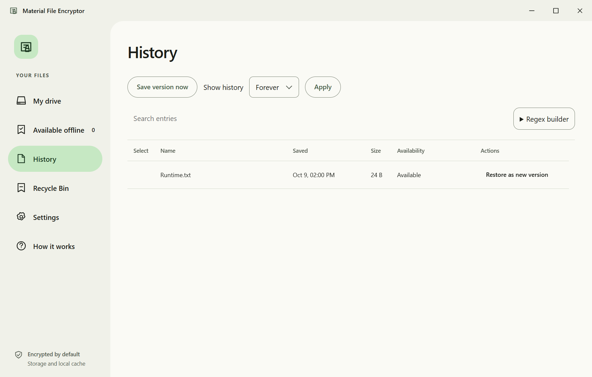

This genuine reviewed capture belongs to historical source **`1e16dea8`**. Its [original provenance](docs/images/captures/preview/inventory.json) and [reviewed gallery inventory](docs/site/gallery-review.json) retain the exact source, image hash and recorded scope. It is **not** the current rebuilt interface. Replacement captures remain pending actual build-bound inspection. The [published historical gallery](https://ding-ding-projects.github.io/material-file-encryptor/gallery.html) preserves original records and their limitations.

## Bounded native measurements

Five initial helper status requests measured 91.678–185.398 ms. One hundred sequential warm status requests measured a 0.167 ms median. These are helper-only JSONL round trips against existing packaged bytes with unverified source binding, not encryption throughput or GUI latency. [All samples, hashes and limits](docs/features/performance/native-helper.md).

## Historical source-bound evidence

The retained record below includes earlier releases, screenshots and incomplete verification. Its source identifiers and limitations remain historical; no result below is promoted to the current integration.

<details>
<summary>Open retained historical project record</summary>

# Preservation handoff, 2026-10-10 UTC

Recorded at 2026-10-10T17:21:07.853617+00:00. Verified account allowance is 10% remaining, the inclusive preservation threshold. The wider goal remains unfinished. No new implementation, build or runtime launch is authorized by this preservation record.

Current main source `4f214ac32f96048e0cc2ee08a11b055235ebb9eb` (I) is pushed and exactly verified, including its task-branch preservation. The minimum source-ID repair adds `-prepare-settings` in production. Focused regression evidence first reported 14 passed/1 failed with 31 unique IDs out of 33, then 15/15 passed after correction. Two independent source reviews are dry. This is source-level repair evidence only; new I local root production and actual runtime execution remain unperformed. Hosted automatic release runs `38071084426` and `38071217163` have terminal success; the observed normal release list shows v1.72.1 and v1.73.1 with draft/prerelease flags false. Full tag/source/assets metadata remains pending readback.

The preceding G runtime lh9oaF at `8b74984bb0e44c00e5a1008009122b497ee85956` passed its first five clear-control measurements, then stopped in first matrix sequence 5 with INVALID_PLAN for duplicate IDs. Zero matrix tuples were accepted. Normal owned closure, credential retirement and fresh final 51-input binding passed. All 91 originals remain preserved, and the exact operational hold was independently closed. These partial G results are not I runtime acceptance.

Normal H release v1.71.1 metadata is verified at source `761e542`, with four assets. Actual H documentation delivery is deployment `6984035573`: 52 files, 18 articles including two wiki pages, 73 anchors, 27 HTML routes and 873 links. Release classification and content delivery do not establish downloaded installation or browser/layout acceptance. The complete current wiki snapshot is copied from exact published revision `43f17a1f7cd24f4079409d1127bc1d145b1c97da`; a later documentation deployment must be verified separately.

Browser E v16 retains 14 completed Home tuples, with all 14 pixels and raw observations independently reviewed. Original normal closure remains unproved and profiles remain retained. Supplemental current absence cannot supply missing original closure evidence. Category/article acceptance remains incomplete. Older source28f's single native observation and OpMyor's two baselines plus three intermediate images retain their original source-specific limits.

Full runtime, all 48 configurations, 13 clear controls, downloaded and installed lifecycle, mounted-copy upgrade and transport workflows, complete browser acceptance and physical display-scale verification remain unfinished. One publication lane is assigned to a public gallery of reviewed genuine captures; publication remains pending. Five working trees and ignored announcement variants remain retained. No cleanup or deletion is claimed. Status Hub session delivery remains unavailable.

Next: preserve and publish this factual handoff and wiki snapshot, verify the exact main remote result and associated instruction preservation, retain all unfinished evidence, and stop discretionary work at this allowance boundary. Future local root production/runtime must bind to its actual source and receipts. Do not convert partial evidence into completion.

# Historical source-bound records

# Current continuation snapshot, 2026-10-10 UTC

Recorded at 2026-10-10T16:59:35.360045+00:00. Continuation remains incomplete. Latest supplied verified account allowance is 14% remaining; preservation starts at 10% remaining, inclusive. No fixed goal token cap is introduced.

Local main contains repair source `8b74984bb0e44c00e5a1008009122b497ee85956` (G), preserved and pushed on `task/native-child-trace-20261010`. Exact fetched remote main remains `f7b206fe77262580313a7f925a0da6771ff74298` (F); main publication of G remains pending. Two independent source reviews of the repair are dry. The first exact G build exited 1 with an allocation failure and remains preserved as unsuccessful history. An isolated parser probe exited zero. Exact `build.bat /s` attempt 2 exited zero at unchanged G source/tree `56915ac5edab1f63cceae0ec07103cdc584e2e42`, followed by exact `build-installer.bat /s` exit zero at the same source/tree. Build receipt SHA-256 is `38ee91a3fecd55c804a6bb8d1546494420e9cfcdf8a3115ccde561cb74bba6c8`; installer receipt SHA-256 is `dbe28f09b7144b0b2190f7584e3f8988e9cd51468df7282c787f538caae9bd4d`. Package verification passed all 739 CRC/decompression entries and 812 privacy entries. Final produced payload inventory contains 644 files. No safe-extraction, downloaded-installation or runtime acceptance is claimed.

The G runtime candidate is prepared with 51 operational inputs, but no actual G GUI run has occurred at this snapshot. The earlier F qCXfCN run completed two baselines and five first clear-control actions, then stopped at layout assertion `752 !== 850`. Two independent reviews confirmed sequence 4 lacked its own emulation setup; the exact detach/reset mechanism remained unproved. That F run accepted zero tuples. Its seven private PNGs, successful owned recovery and original receipts remain source-specific. Older source28f's single successful native observation and OpMyor's two genuine baselines plus three intermediate PNGs remain separate historical evidence, not G acceptance.

Live documentation remains source `b1564bac7cdb6677ff5d9529e65228577d406259` (E), run `38056096898`, deployment `6981581764`: 52 live matching files, 18 articles including two wiki pages, 71 article anchors, 27 HTML routes and 871 links; eight excluded paths returned 404 and stored About homepage matched exactly. Browser v16 at E retained 14 completed Home tuples before interruption. Original terminal result and normal-closure receipts are missing. Category and article pages were not launched; no full browser acceptance is established. The post-interruption audit at 2026-10-10T16:41:12.082662Z found the recorded process, desktop and listener absent, retained the profile, and preserved 2,975 files without preservation faults. This supplemental current absence does not prove original normal closure. The original hold remains unreleased in that audit. Retained raw observations and pixels require their source-specific review verdicts and do not replace missing terminal evidence.

Normal F releases v1.68.1 and v1.69.1 remain historical release metadata, separate from G production and unperformed downloaded/installed acceptance. Full runtime, 48 configurations, 13 clear controls, installed lifecycle, mounted-copy upgrade and transport workflows, full browser acceptance and physical display-scale verification remain unfinished. Preserve original unsuccessful evidence and profiles. Next: review and publish completed G source and this factual documentation to main with exact remote proof, then run only a separately authorized, source-bound candidate. Do not relabel older captures or current absence as acceptance. Own Status Hub session tooling remains unavailable.

# Historical source-bound records

# Material File Encryptor

> Snapshot 2026-10-10T13:17:32.963261+00:00: source `28f37a0d` worker-context repair has two dry source reviews and both exact root entrypoints passed with 739-entry integrity and 812-entry privacy. Retained 8 Python/13 JavaScript tool-return strings lack original timestamps and full streams. Task-branch preservation is verified; main publication remains pending. Normal v1.65.1 and actual 52-file/18-article/70-anchor/870-link documentation delivery belong to source63. Prior ad473 modern execution stopped before measured tuples; modern28 v2 actual OpMyor execution stopped at the first clear-controls tuple with SELECTOR_ACTION_FAILED; two baselines, zero accepted tuples and normal owned recovery are preserved, with all 51 final pins matching. Two independent reviews confirm reversed verifier host/wrapper selector topology; actual failed-query state remains unrecorded and no product clear defect is proven. One exact native observation passed before the stop, with DPI144/effective1.5 and physical-scale matrix false. The owner closed only this run-specific installed hold. Browser v12 has three synthetic stream cases and two dry reviews, while real profile operation and deployment rebinding remain pending. Installation, full workflows, modern matrix and browser acceptance remain incomplete. See [the current handoff](HANDOFF.md).

A Windows Explorer drive with encrypted fixed-size content blobs, recoverable history, and a Recycle Bin. Choose a synchronized folder or a private GitHub repository for transfer. Keep selected files available offline in an encrypted local cache.

**Historical development evidence:** packaged source `1e16dea8` passed 70 actual Windows GUI checks with all 73 captures inspected, including create/unlock dialogs, drive-letter selection, mounted-byte persistence, History and Recycle Bin recovery. The same source passed 39 JavaScript checks (one platform-specific skip), 34 core checks, eight controller groups and full 739-entry Squirrel package integrity verification. Earlier source-bound evidence includes 39 actual mounted-drive checks and ten live private transport checks. The integrated test-only transport fixture repair passed 42 checks at `d0c5e036`; the native source matches the integration tree. Setup, 573-entry installed-payload comparison and registration checks passed; installed application execution passed 70 checks with 72 inspected captures. Uninstall returned zero but its directory-presence check rejected updater-only residue; a separate read-only classification now verifies those exact updater hashes while preserving the original failed receipt. Normal release [v1.19.1](https://github.com/Ding-Ding-Projects/material-file-encryptor/releases/tag/v1.19.1) is published from `57a04e16`, with all four assets independently downloaded and hash-verified. Final downloaded runtime and modern-interface acceptance remain pending. A private local-package exclusion defect is quarantined; the downloaded release archive contains zero private announcement entries. [Exact source revisions and evidence boundaries](docs/features/release/preview-verification.md) · [Sanitized verification summary](docs/images/captures/preview/verification-summary.json). Historical captures below retain their earlier source boundaries.

[Project goal](GOAL.md) · [Interface design](DESIGN.md) · [Source](https://github.com/Ding-Ding-Projects/material-file-encryptor) · [Documentation site](https://ding-ding-projects.github.io/material-file-encryptor/) · [Windows verification](https://github.com/Ding-Ding-Projects/material-file-encryptor/actions/workflows/windows.yml)

## History and recovery

Format 2 keeps separate ciphertext-addressed chunks and encrypted snapshot metadata in real Git history. Versions are saved after 30 seconds without writes to a file, or with **Save version now**. Retention defaults to forever; the restore-list period does not erase history. Deleted files remain recoverable from the Recycle Bin, and emptying it preserves historical recovery without promising reclaimed space. Existing vaults require an explicit verified copy upgrade. [Storage and recovery guide](docs/features/storage/history-and-recycle-bin.md) · [Transport details](docs/features/storage/git-transport.md).

## Verified preview captures

These four original captures come from packaged source `1e16dea8edb66ea5e6cf31009b0dbcc953f18d74`, at 1180 × 752 and 150% scale on 2026-10-09 UTC. The actual drive workflow passed 70 recorded checks and all 73 captures were inspected. Create/unlock controls, mounted bytes, history recovery, explicit descendants, offline pinning and startup restoration were exercised. Path-bearing captures remain private. Installation and release download checks are reported separately. [Capture inventory and hashes](docs/images/captures/preview/inventory.json).


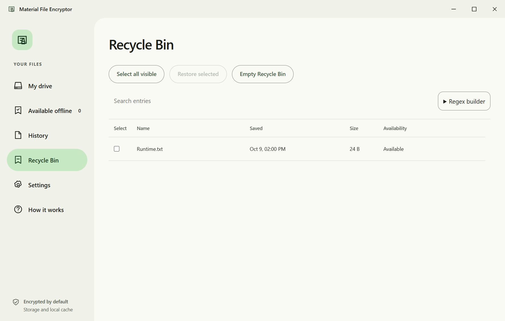

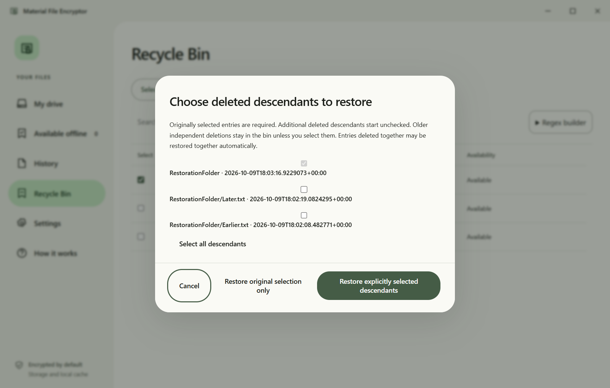

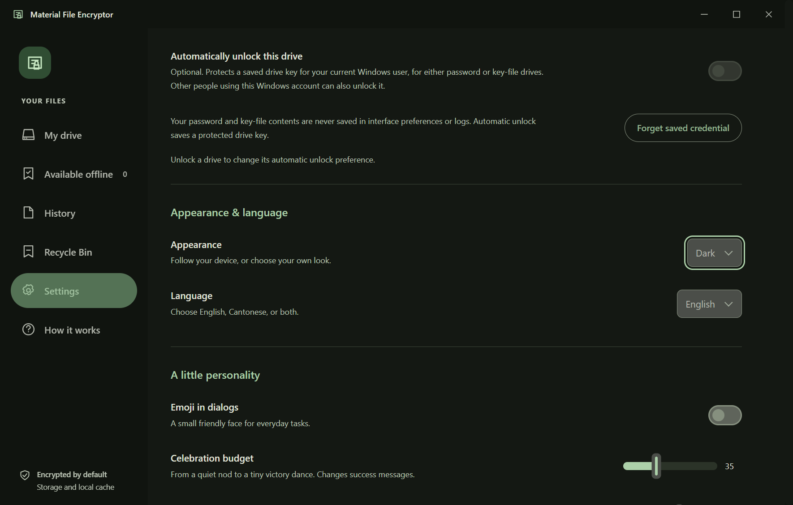

## How it works

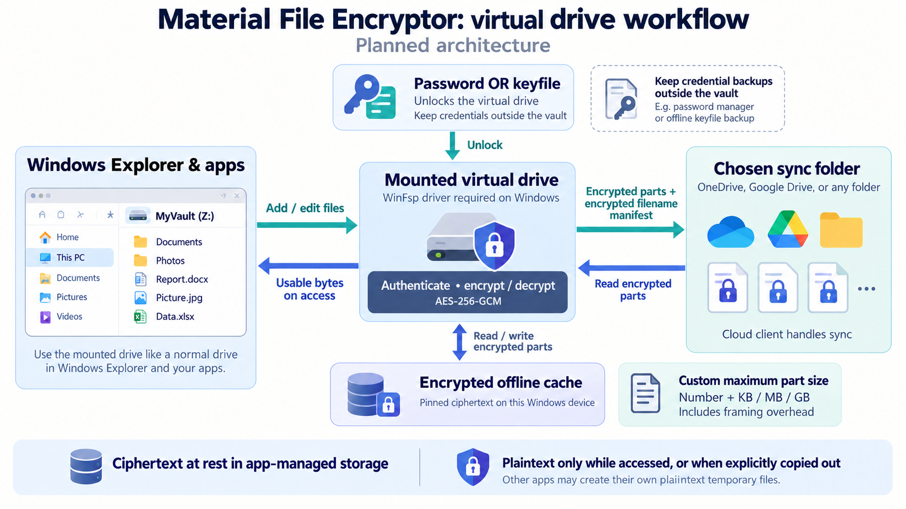

The mounted drive returns authenticated, decrypted bytes when applications read files. New and edited files become encrypted records and parts in the selected backing folder. Your existing cloud client transfers those encrypted objects between devices.

The documentation site includes an [interactive workflow explanation](https://ding-ding-projects.github.io/material-file-encryptor/#interactive-workflow) with selectable steps, access modes, and encrypted part sizes. Its illustrations explain the design; they are separate from native verification.

<details>
<summary>Real Linux application captures</summary>

These captures show the actual Electron application at source commit `2a9887009f3bb2b64a3e5be37754d1d6612b6fd1`, driven through its sandboxed renderer on an isolated Linux display at 1180 × 850. They verify interface states; native Windows evidence is recorded separately in the linked workflow. [Capture provenance and image hashes](docs/images/captures/provenance.json).

The historical recording is excluded from current website delivery pending a separate privacy review.

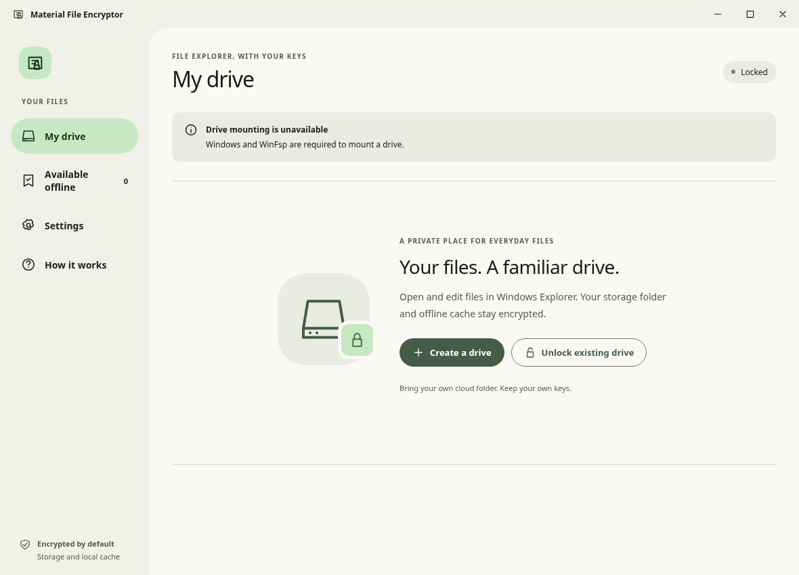

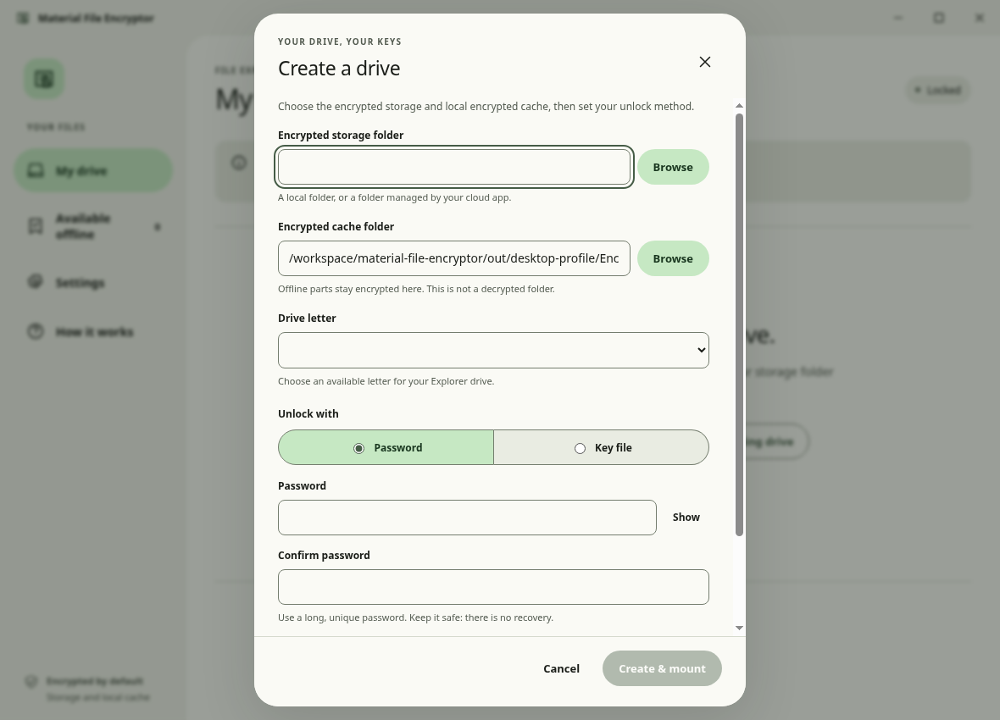

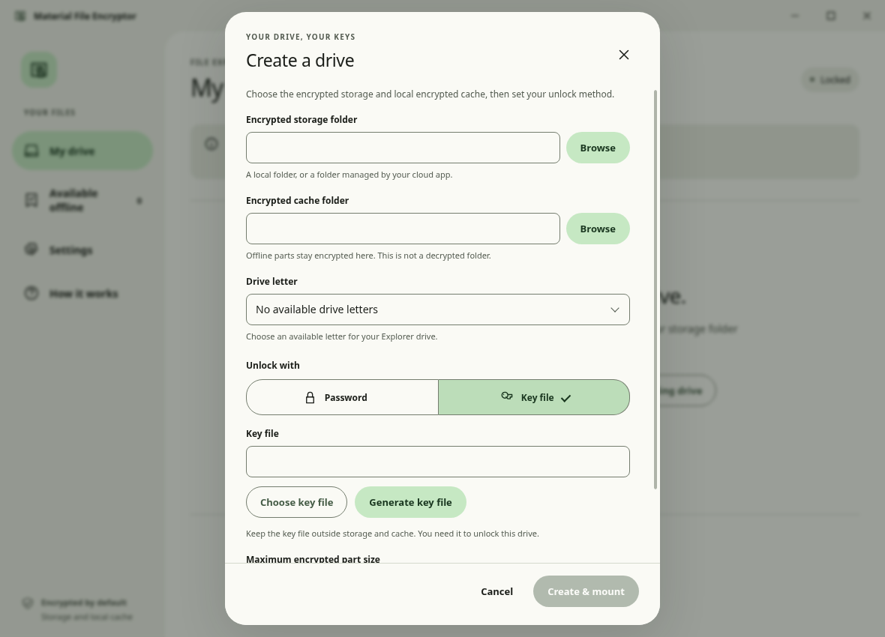

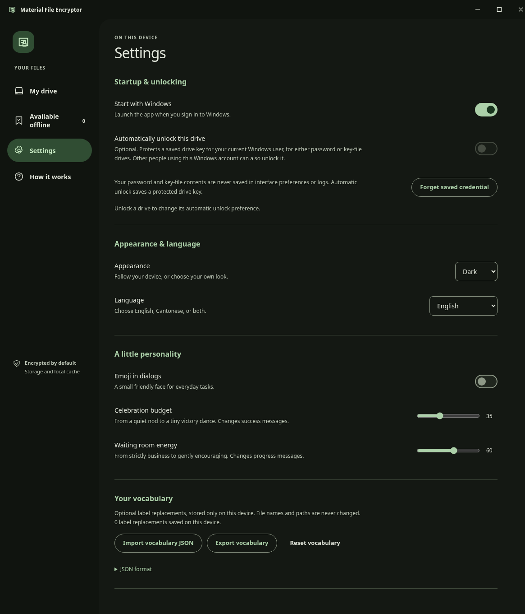

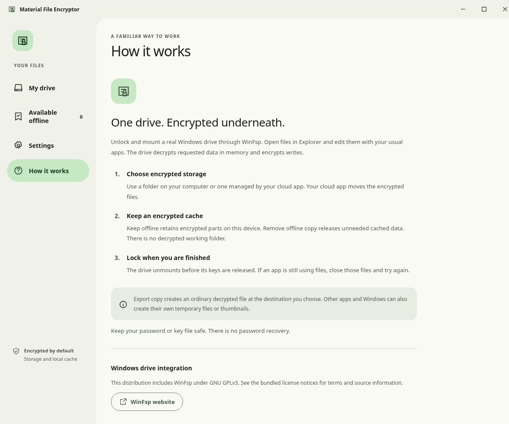

</details>

<details>
<summary>Real Windows application captures</summary>

These five reviewed original viewport captures show the actual packaged Electron application at source `c74b3a6828e3d1893015598f2df1c9bd4ce84c32` on a disposable Windows Server 2022 runner. Ordinary mounted file access, encrypted offline pinning, startup registration toggles and graceful locking passed. They do not prove the later installed-app or uninstall checks. Per-image capture timestamps were not recorded. [Provenance and original receipts](docs/images/captures/windows/provenance.json) · [Windows run](https://github.com/Ding-Ding-Projects/material-file-encryptor/actions/runs/37863451177).

The Windows recording and two original mounted/offline captures are withheld from current delivery because their pixels contain machine paths. Original bytes are privately preserved and hash-verified without editing; historical publication is not erased.

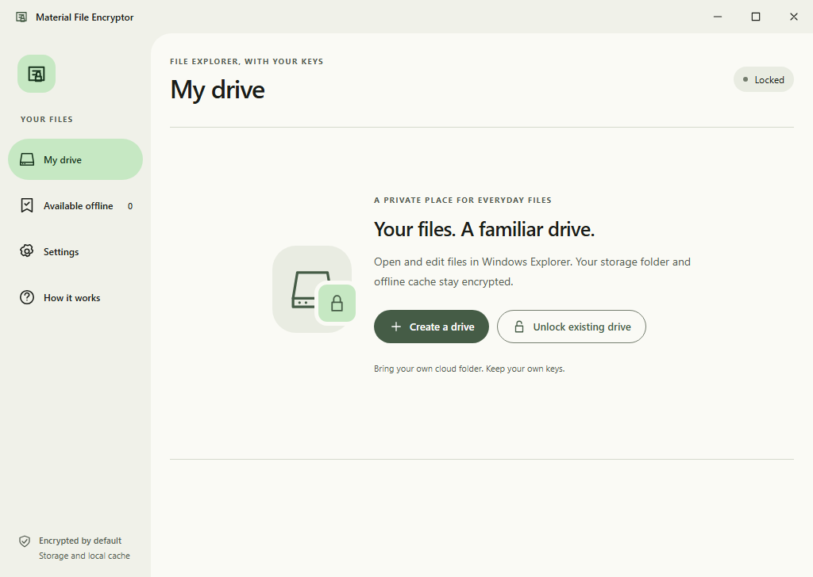

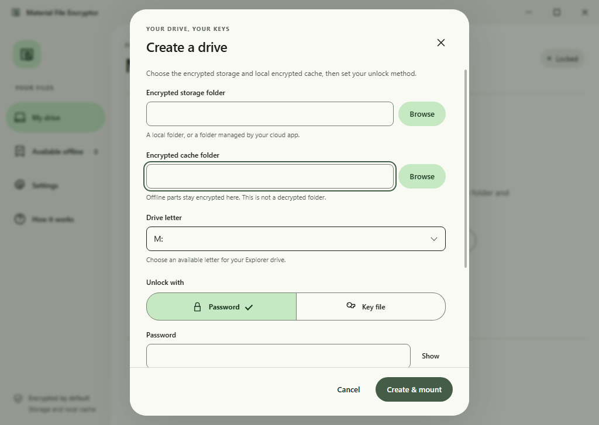

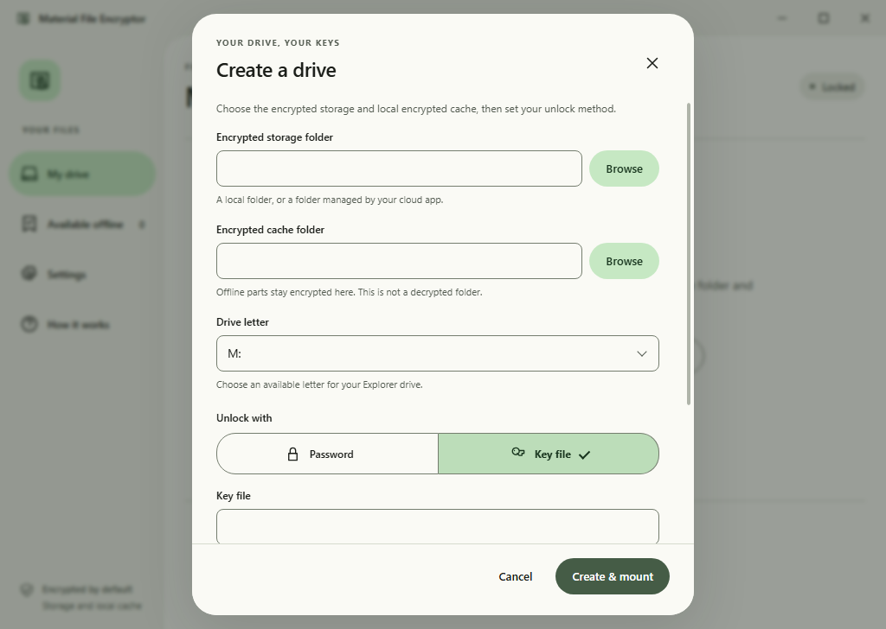


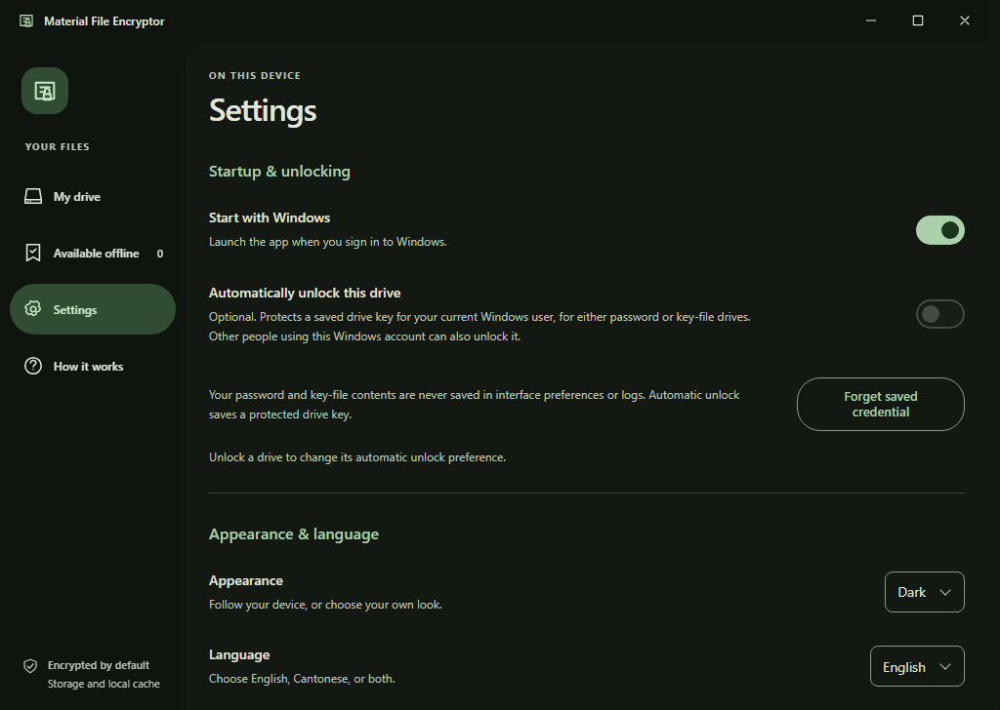

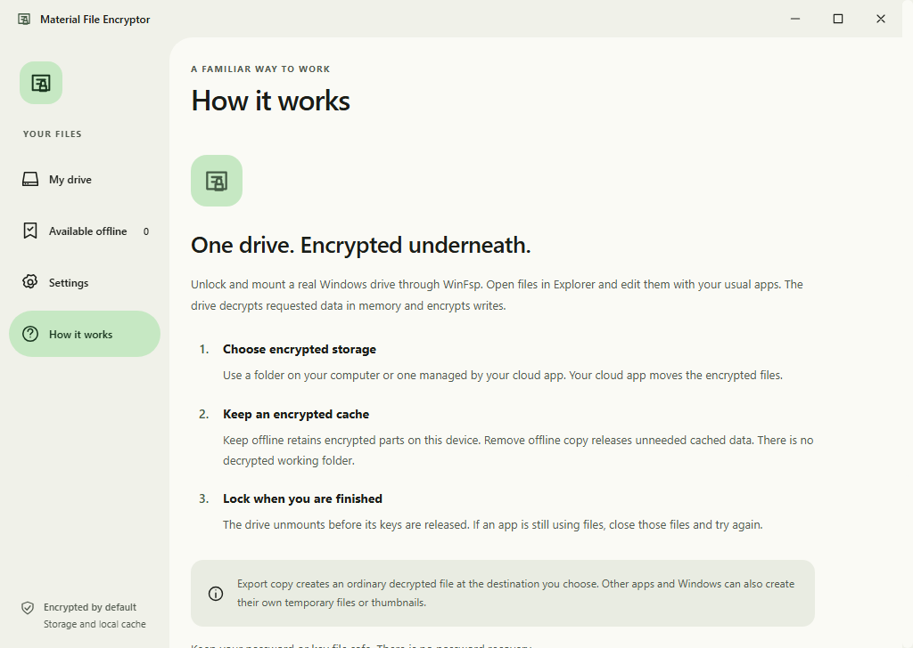

</details>

<details>
<summary>Access, offline use, startup, and split sizes</summary>

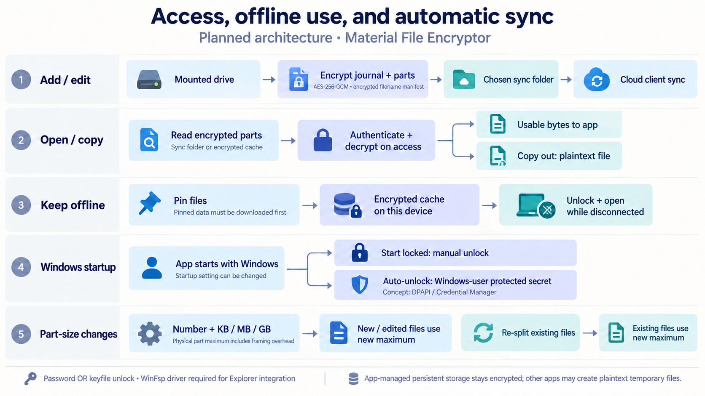

- Unlock with a password or key file. Optional automatic unlock protects the remembered vault key for the current Windows user.
- Start the app with Windows; choose whether to unlock automatically.
- Keep offline downloads and pins encrypted data. Files still decrypt through the mounted drive when accessed.
- The default physical encrypted chunk size is 10 MiB. The hard maximum is 90,000,000 bytes including cryptographic framing; the final chunk can be shorter. New and edited files use the selected limit; **Re-split existing files** is a separate operation.
- Keep credentials and their backups outside encrypted storage and the cache. Losing all unlock credentials loses access.
- Copying a file outside the mounted drive intentionally creates a plaintext copy. Applications and Windows may create their own temporary files, thumbnails, or paging data.

</details>

<details>
<summary>Build and verification status</summary>

Windows 10/11 x64 is the delivery target. Explorer integration requires the genuine WinFsp filesystem driver. From a fresh Windows checkout, build and start the app with:

```powershell
cmd /c "build.bat /s && out\material-file-encryptor-win32-x64\MaterialFileEncryptor.exe"
```

The build obtains verified user-scoped Node and .NET tools, portable Git and GitHub CLI distributions, and the signed WinFsp installer. Explicit local verification installs its own browser tools when required; production builds do not run tests or lint. If the driver is missing, **Install WinFsp** opens the bundled installer with its normal Windows elevation flow. Reopen the app after driver installation. `build-installer.bat /s` produces a genuine unsigned Squirrel.Windows installer; Windows publisher warnings are expected for the app installer.

Local verification covers the encrypted engine, range I/O, recovery, conflicts, offline pins, part limits, desktop bridge and renderer interactions. Real Electron captures on Linux verify interface behavior and isolation; they do not prove Windows Explorer mounting. Every authorized branch push and manual dispatch builds, packages and publishes a unique normal non-draft Windows release without tests or lint. Release notes state that runtime verification is pending and include the exact source, workflow run and timing. Mounted-drive and installed-lifecycle verification run explicitly on a local Windows account with isolated fixtures.

</details>

## Gallery pipeline candidate

The gallery pipeline now groups the unchanged 14 historical originals by workflow, projects only approved public metadata and preserves every occurrence of identical image bytes. Two exclusions remain explicit. Twenty-seven focused checks pass, including a synthetic 445-occurrence case and privacy/search rejection regressions. Independent source review is complete with no remaining findings. Rendered acceptance and main integration remain pending. No current runtime original or new publication is claimed. See [the evidence contract](docs/features/desktop/runtime-evidence.md#reviewed-gallery-publication-pipeline).

</details>
