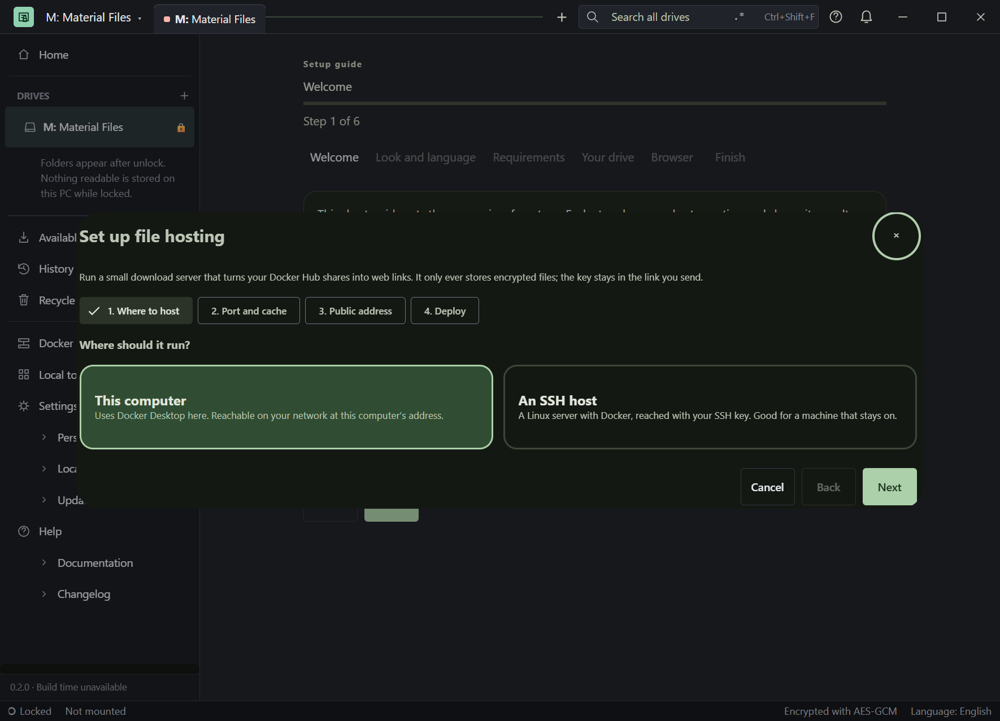
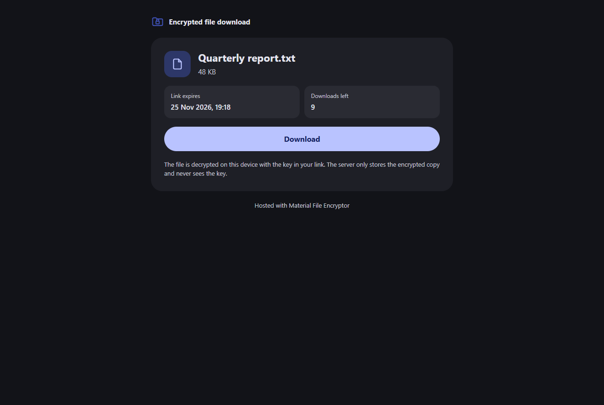
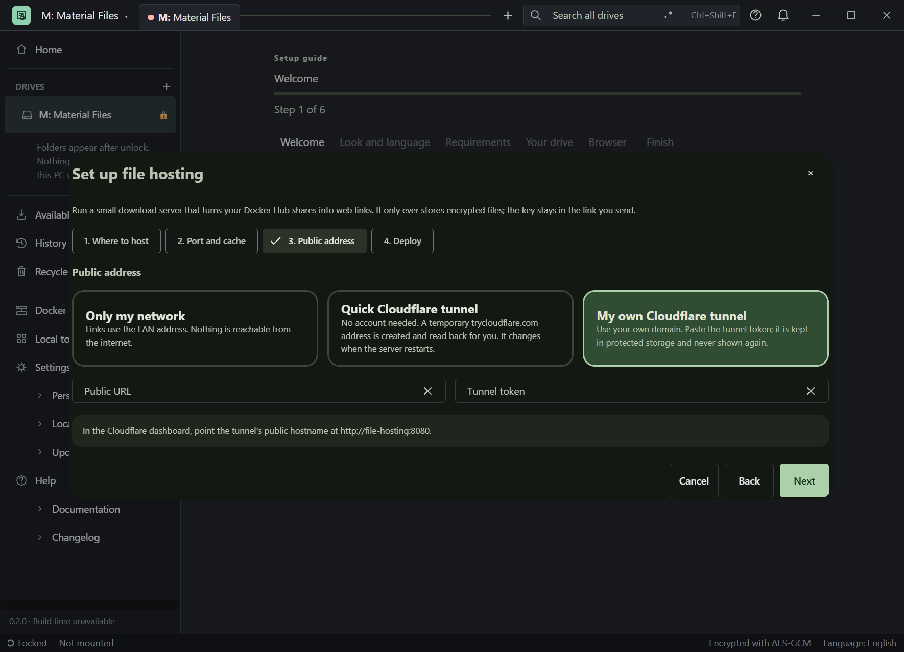

# File hosting: web links for shared files

[Share via Docker Hub](share-via-docker-hub.md) gives you a command that only Material File Encryptor can open. **File hosting** turns the same share into an ordinary web link that opens in any browser, with an expiry, an optional download limit and a QR code. It runs as a small server you deploy with one click, on this computer or on a Linux server you reach over SSH, and you can give it a public address through a Cloudflare tunnel.

## How it works

1. You share a file through Docker Hub as before. The file is encrypted on your computer and uploaded to your public `<account>/material-file-encryptor-shares` repository.
2. You choose **Web link…** on that shared file (or **Create a download link…** in the command palette). The app asks your server to host that share and gives you a link such as `https://files.example.com/d/<id>#<key>`, plus its QR code.
3. When someone opens the link, the server downloads the encrypted file from Docker Hub once, checks its digest, caches it, and streams the encrypted bytes to the browser. The page decrypts the file in the browser with the key after `#`.

The part after `#` is never sent to any server by a browser, so the hosting server only ever holds ciphertext and cannot read what it hosts. It never learns the file name either: the name is inside the encrypted data and the page reads it from the first encrypted chunk.

A share protected with a passphrase still needs it: the page asks for it and unwraps the key in the browser (scrypt, the same parameters as the app). A wrong passphrase is refused with a plain message.

## Set up file hosting

Open **File hosting** from the command palette or the New tab catalog, or **Set up file hosting…**. The wizard has four steps:

| Step | What you choose |
|---|---|
| Where to host | **This computer** (Docker Desktop) or **An SSH host** (host, user, port, optional key file; otherwise ssh-agent). The host key must already be trusted: connect once with `ssh` first. |
| Port and cache | Instance name, web port (default 8790) and cache size limit. A random admin key is created and kept in Windows protected storage. |
| Public address | **Only my network** (LAN link), **Quick Cloudflare tunnel** (no account; a temporary `trycloudflare.com` address read back for you, which changes when the server restarts) or **My own Cloudflare tunnel** (your domain and tunnel token; point the tunnel's public hostname at `http://file-hosting:8080`). |
| Deploy | Check Docker, write compose and settings, pull the published image, start containers, wait for a real health check, read the public address. Each phase shows its state. |

Deploying writes `compose.yaml`, `.env`, `hosting.env` (the admin key) and, for your own tunnel, `tunnel.env` (the tunnel token) into the instance folder: under the app's data folder on this computer, or `~/material-file-encryptor-hosting/<name>/` on an SSH host. The secret files are written owner-only. Deploying again with the same name keeps the same admin key, so existing links keep working.

If the image cannot be downloaded but the exact image is already on the host, deployment continues with that copy and says so; use **Update** once the host is online.

You can run several instances, on one host or on several; ports must not collide on the same host.

## Create a link

Pick the shared file and the instance, then:

- **Link expires**: 1 hour, 1 day, 7 days, 30 days or a date and time (24-hour). Between one minute and one year.
- **Delete after**: no limit, 1, 3, 10 or a custom number of downloads. A download counts only when the whole file was sent.
- **Also remove the file from Docker Hub when the link ends**: when the link expires, is used up or is ended, the app revokes the Docker Hub share too (the next time it lists the links).
- **Download it into the server cache now**: the server fetches the encrypted file immediately.

The result shows the link, a QR code for phones, **Copy link** and **Save QR as PNG**.

## Manage

The **File hosting** page checks each instance's health when it opens, never assuming it: version, uptime, cache use and its addresses. Actions: **Check health**, **Restart**, **Update** (pull the newest image and restart), **Logs**, **Stop** / **Start**, **Remove** (deletes its containers, cache and saved links; Docker Hub shares are untouched). Remove, Stop, Restart, Update and **End now** on a link pass the two-key confirmation.

The link list shows each link's file, expiry, downloads and state (active, expired, used up, ended, or removed from Docker Hub), with **Copy**, **QR** and **End now**.

## Running the server yourself

The server is in [`file-hosting/`](../../../file-hosting/): a Node.js program with no dependencies, a `Dockerfile`, and a [`compose.yaml`](../../../file-hosting/compose.yaml). The image is published by the `File hosting image` workflow as `ghcr.io/ding-ding-projects/material-file-encryptor-hosting` for amd64 and arm64, tagged with the commit and, on main, with the server version and `latest`. Create `hosting.env` with `ADMIN_TOKEN=<at least 32 random characters>` next to `compose.yaml`, then `docker compose up -d` (add `--profile quick-tunnel` or `--profile named-tunnel`).

HTTP routes: `GET /api/health`; `GET /d/<id>` (the page); `GET /api/links/<id>` (size, expiry, downloads left); `GET /api/links/<id>/head` (the first encrypted chunk, not counted); `GET /api/links/<id>/blob` (the encrypted file, counted when complete); and, with `Authorization: Bearer <admin key>`, `GET /api/admin/status`, `GET|POST /api/admin/links`, `DELETE /api/admin/links/<id>` (`?forget=1` also removes the record).

## Security notes

- The link is a bearer secret, like the share command. Send it privately.
- The server stores only ciphertext, link records (repository, digest, sizes, times, counts) and its admin key. No file name, key or passphrase.
- It accepts only repositories named `<account>/material-file-encryptor-shares`, checks the manifest, config and layer by digest and size, and never sends its Docker Hub token to the storage host a blob redirects to.
- Pages are served with a strict Content Security Policy (scripts only from the server itself, no third-party assets), no referrer and no framing.
- Admin requests to an SSH host go through an SSH port forward, not over the network in plain HTTP. Ten wrong admin keys from one address within ten minutes are refused for ten minutes.
- The Cloudflare tunnel token is kept in protected storage and in an owner-only file next to the compose file. Quick tunnels are public addresses on `trycloudflare.com`.

## Verification

Automated tests cover the server (download, cache reuse, download limit, expiry, admin key, foreign repository refusal, removed share, tampering, the browser decryption code including a real passphrase share), the desktop planning and deployment (settings validation, owner files, exact docker and ssh commands, LAN address choice, link creation with the key only after `#`, Docker Hub removal when a link ends) and the dialog model. A real local run built the image, started it with the tracked `compose.yaml`, reached it on the LAN address, deployed it through the wizard, opened the management page, and decrypted a test file in a browser byte for byte. Not yet verified: the published image (first workflow run), a real Docker Hub share through a deployed server, SSH hosts, both tunnel kinds, and an installed packaged build.
