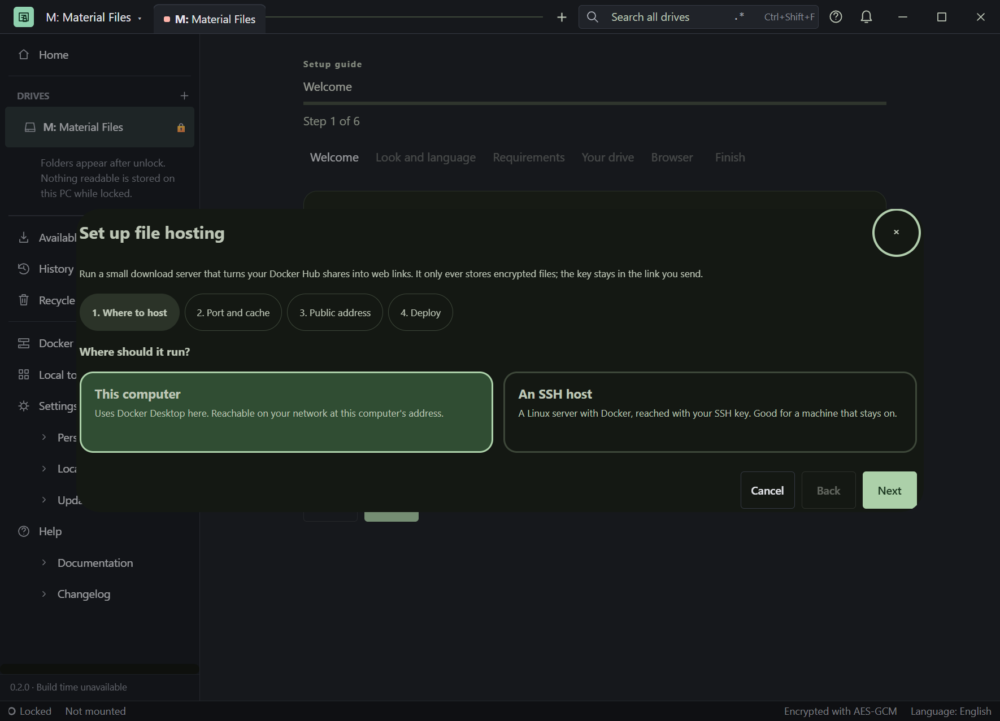
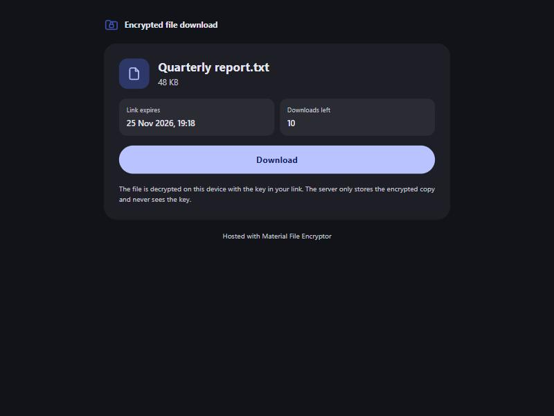
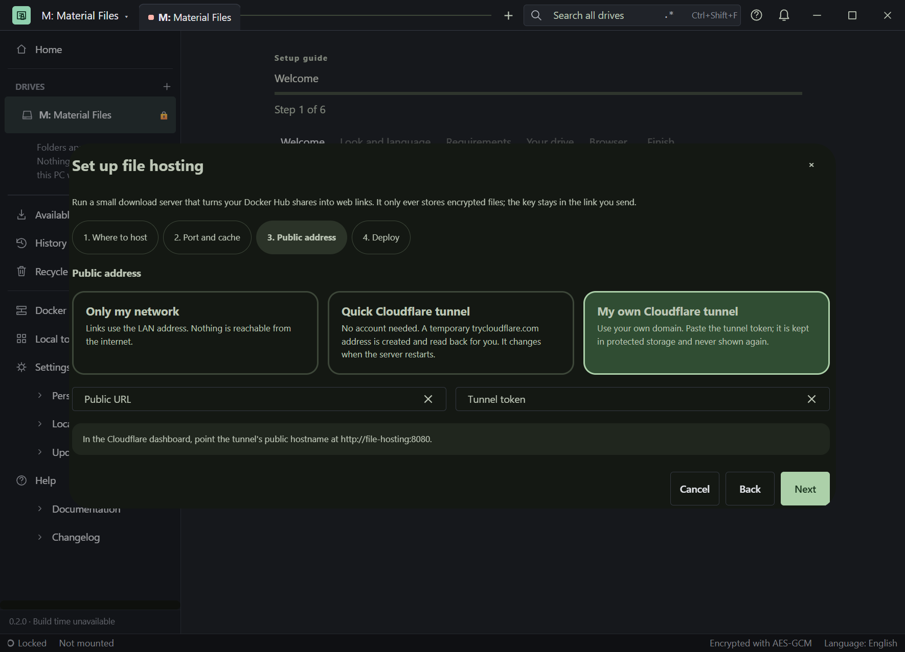

# 檔案寄存：分享檔案嘅網頁連結

[經 Docker Hub 分享](share-via-docker-hub.zh-HK.md) 會俾你一個只有 Material File Encryptor 先開到嘅指令。**檔案寄存**將同一個分享變成普通網頁連結，任何瀏覽器都開到，可以設到期時間、下載次數上限，仲有 QR code。佢係一個細伺服器，一粒掣就部署到呢部電腦或者經 SSH 連到嘅 Linux 伺服器，亦可以用 Cloudflare 隧道俾佢一個公開地址。

## 點運作

1. 照舊經 Docker Hub 分享檔案。檔案喺你部電腦加密，再上載去你公開嘅 `<帳戶>/material-file-encryptor-shares` 儲存庫。
2. 喺嗰個分享檔案揀 **網頁連結…**（或者喺指令面板揀 **建立下載連結…**）。程式叫你嘅伺服器寄存嗰個分享，俾你一條好似 `https://files.example.com/d/<id>#<鎖匙>` 嘅連結，連埋 QR code。
3. 有人打開連結，伺服器會由 Docker Hub 下載加密檔案一次、核對摘要、放入緩存，再將加密資料傳去瀏覽器。網頁用 `#` 後面嘅鎖匙喺瀏覽器解密。

瀏覽器從來唔會將 `#` 後面嗰段傳去伺服器，所以寄存伺服器只會有密文，睇唔到內容，連檔名都唔知：檔名喺加密資料入面，網頁由第一段加密資料讀出嚟。

有密碼短語嘅分享仍然要輸入密碼短語：網頁會問，再喺瀏覽器解開鎖匙（scrypt，參數同程式一樣）。密碼短語錯就會清楚講明。

## 設定檔案寄存

喺指令面板或者新分頁目錄打開 **檔案寄存**，或者 **設定檔案寄存…**。精靈有四步：

| 步驟 | 揀乜 |
|---|---|
| 喺邊度寄存 | **呢部電腦**（Docker Desktop）或者 **SSH 主機**（主機、用戶、連接埠、可選鎖匙檔案，唔填就用 ssh-agent）。主機鎖匙要已經被信任：先用 `ssh` 連一次。 |
| 連接埠同緩存 | 執行個體名稱、網頁連接埠（預設 8790）同緩存上限。會整一條隨機管理鎖匙，存喺 Windows 受保護儲存。 |
| 公開地址 | **只限我嘅網絡**（區域網絡連結）、**快速 Cloudflare 隧道**（唔使帳戶；臨時 `trycloudflare.com` 地址，伺服器重開會變）或者 **我自己嘅 Cloudflare 隧道**（你嘅網域同隧道權杖；將公開主機名指去 `http://file-hosting:8080`）。 |
| 部署 | 檢查 Docker、寫入設定、下載已發佈映像、啟動容器、等真正嘅健康檢查、讀取公開地址。每個階段都顯示狀態。 |

部署會喺執行個體資料夾寫入 `compose.yaml`、`.env`、`hosting.env`（管理鎖匙），用自己隧道就再加 `tunnel.env`（隧道權杖）；呢部電腦就喺程式資料夾，SSH 主機就喺 `~/material-file-encryptor-hosting/<名稱>/`。秘密檔案只有擁有者讀到。同名再部署會沿用同一條管理鎖匙，舊連結繼續用得。

如果下載唔到映像但主機已經有一模一樣嘅映像，部署會用嗰個副本並講明；主機上網之後撳 **更新**。

可以行幾個執行個體，同一部或者唔同主機都得；同一部主機上連接埠唔可以撞。

## 建立連結

揀分享檔案同執行個體，然後：

- **連結到期**：1 小時、1 日、7 日、30 日或者指定日期時間（24 小時制），一分鐘至一年之內。
- **幾多次下載後刪除**：冇上限、1、3、10 或者自訂次數。完整傳送先計一次下載。
- **連結結束時，順手喺 Docker Hub 移除個檔案**：連結過期、用晒或者被結束之後，程式下次列出連結時會撤銷 Docker Hub 分享。
- **而家先下載入伺服器緩存**：伺服器即刻攞加密檔案。

結果會顯示連結、手機用嘅 QR code、**複製連結** 同 **將 QR 存做 PNG**。

## 管理

**檔案寄存** 頁面一打開就檢查每個執行個體嘅健康，唔會假設：版本、運行時間、緩存用量同地址。動作：**檢查健康**、**重新啟動**、**更新**（下載最新映像再重開）、**記錄**、**停止**／**啟動**、**移除**（刪除容器、緩存同已存連結；Docker Hub 分享唔受影響）。移除、停止、重新啟動、更新同連結嘅 **即刻結束** 都要過雙重確認。

連結清單顯示每條連結嘅檔案、到期、下載次數同狀態（有效、已過期、用晒、已結束或者已喺 Docker Hub 移除），有 **複製**、**QR** 同 **即刻結束**。

## 自己行伺服器

伺服器喺 [`file-hosting/`](../../../file-hosting/)：一個冇依賴嘅 Node.js 程式、`Dockerfile` 同 [`compose.yaml`](../../../file-hosting/compose.yaml)。映像由 `File hosting image` 工作流程發佈做 `ghcr.io/ding-ding-projects/material-file-encryptor-hosting`（amd64 同 arm64），用提交標記，喺 main 再加伺服器版本同 `latest`。喺 `compose.yaml` 旁邊建立 `hosting.env`，寫 `ADMIN_TOKEN=<最少 32 個隨機字元>`，再 `docker compose up -d`（可加 `--profile quick-tunnel` 或 `--profile named-tunnel`）。

## 安全

- 連結同分享指令一樣係持有就用得嘅秘密，請私下傳送。
- 伺服器只存密文、連結記錄（儲存庫、摘要、大小、時間、次數）同管理鎖匙，冇檔名、鎖匙或者密碼短語。
- 只接受 `<帳戶>/material-file-encryptor-shares` 儲存庫，逐樣核對摘要同大小，亦唔會將 Docker Hub 權杖送去重新導向嘅儲存主機。
- 網頁用嚴格內容安全政策，唔載入第三方資源。
- 去 SSH 主機嘅管理請求行 SSH 埠轉發，唔會喺網絡用明文 HTTP。同一地址十分鐘內錯十次管理鎖匙，會被拒絕十分鐘。

## 驗證

自動測試涵蓋伺服器、桌面部署規劃同對話框模型。實機試過：建立映像、用 `compose.yaml` 啟動、喺區域網絡地址連到、經精靈部署、打開管理頁，同埋喺瀏覽器逐個位元組解密測試檔案。未驗證：已發佈映像（第一次工作流程）、經已部署伺服器嘅真實 Docker Hub 分享、SSH 主機、兩種隧道，同已安裝嘅封裝版本。
